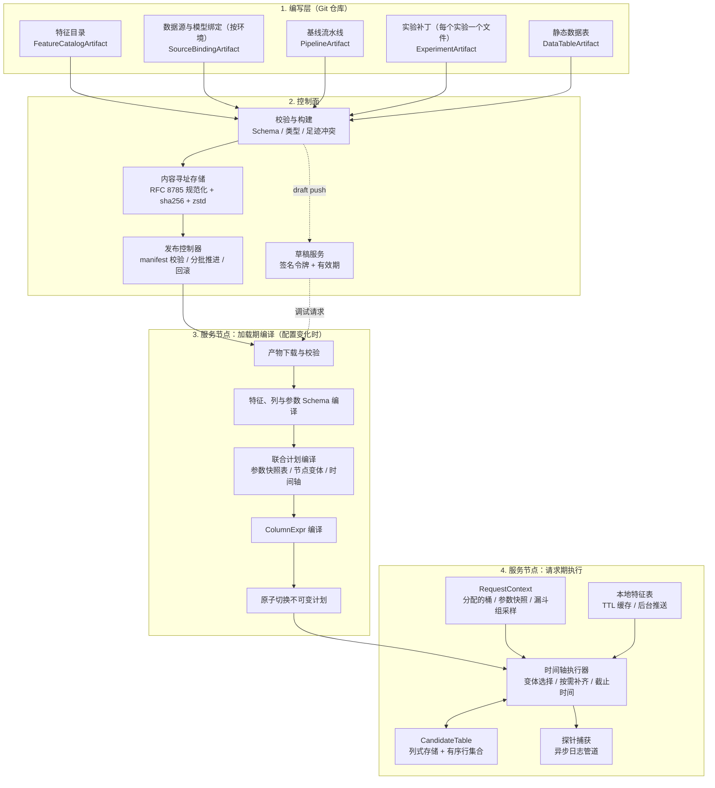
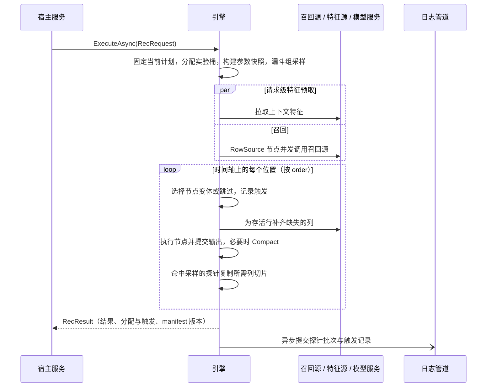
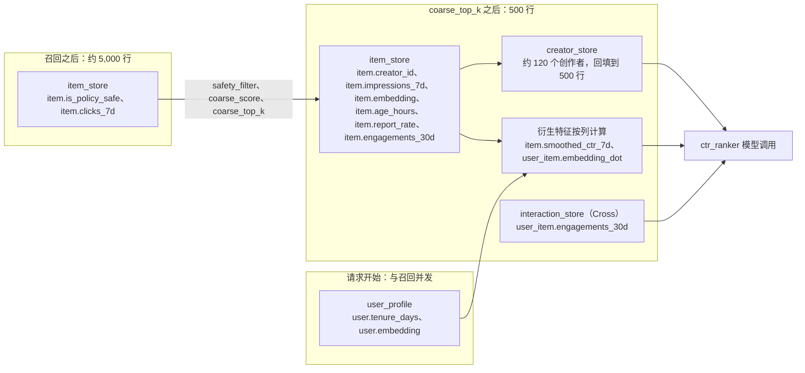
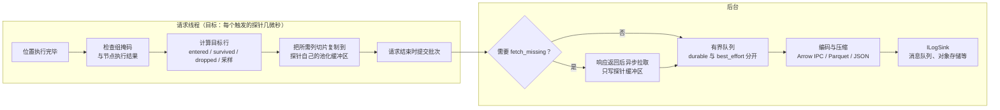
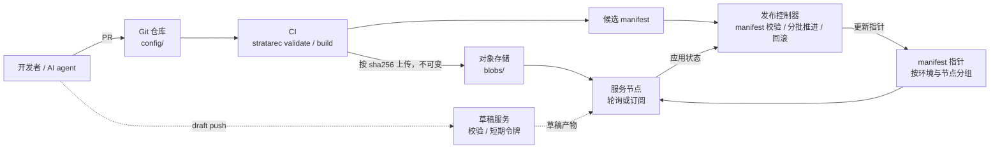
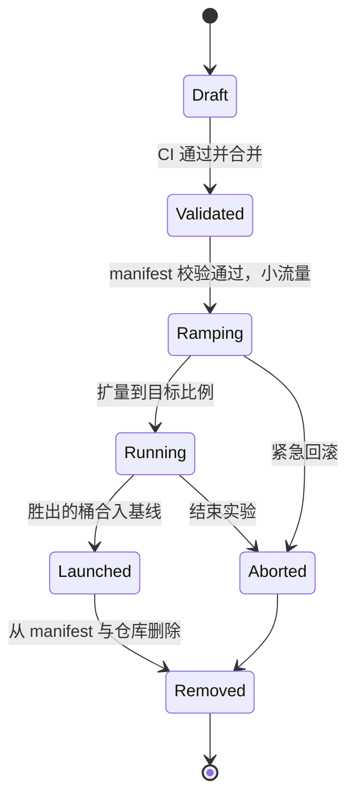

# StrataRec：列式推荐执行与多层实验引擎设计

> 实现中对本设计的调整、取舍和尚未实现的部分记录在 [`decisions.md`](decisions.md)，两者冲突时以 `decisions.md` 和代码为准。

StrataRec 是一个通用、开源的推荐、搜索排序与实时决策执行引擎，运行在 .NET 8 及以上版本。

## 0. 摘要

StrataRec 是一个在服务进程内运行的推荐执行引擎库。一次推荐请求被表达为一条按顺序执行的节点流水线，节点在一张列式候选表上完成召回、特征补齐、打分、过滤、重排与截断。流水线结构、公式、参数、特征定义和日志探针都写在声明式配置产物里；服务二进制只提供通用算子、表达式编译器、特征连接器、模型客户端和日志管道。

设计围绕五个决定展开：

1. **列式执行**：候选集按列存放在连续数组中，算子和表达式一次处理整列。请求热路径上数值计算的托管内存分配与候选数量无关。
2. **加载期编译**：配置下发到服务节点时编译一次，得到不可变的执行计划。请求期不解析 JSON，也不按名字查找列。
3. **标准补丁与联合计划**：每个实验桶是对基线的一个 RFC 7396 JSON Merge Patch。服务节点把基线和全部实验编译成一张联合计划，请求按自己被分配的实验桶选择执行路径。编译规模取决于每个节点被多少实验桶修改，与实验组合总数无关；正常情况下每个节点只有少数几个变体。
4. **实验相互独立**：实验只能基于基线编写，所以任何实验都能单独上线、单独回滚，回滚不需要重新校验。
5. **只做声明过的事**：引擎只拉取被使用的特征，只记录探针声明的列，实验只修改补丁里出现的路径。

## 1. 背景、目标与范围

### 1.1 要解决的问题

大规模推荐、搜索排序和信息流系统同时承受两种压力：线上要求高吞吐、低延迟；算法团队要求每周并发上线、下线几十个实验。常见的做法落在两端。

**把流水线写成代码。** 执行快，类型安全。但每个改动都要随二进制发布才能在线上验证，实验分支会以条件判断的形式堆积在主干代码里，同一个二进制中打包的多个无关改动也无法单独回滚。

**使用通用的规则引擎或工作流引擎。** 改动不需要发版。但通用引擎不理解候选集、特征和实验：它通常在请求期逐个对象求值，开销随候选数量增长；它缺少面向排序场景的静态检查；多个实验同时修改同一条流水线时，也没有清晰的合并和冲突规则。

StrataRec 取两者之长：执行方式接近手写代码，变更方式像配置一样快速、可预览、可独立回滚。

### 1.2 运行示例

本文用一个信息流作为贯穿全文的示例：

1. 6 路召回并发返回候选，按 `entity_id` 去重后约 5,000 个；
2. 安全过滤；
3. 用轻量公式粗排，保留前 500 个；
4. 为这 500 个候选补齐物品、创作者和用户-物品交叉特征；
5. 模型输出点击率、点赞率等多个目标；
6. 多目标融合得到最终分，排序后保留前 200 个；
7. 按创作者做多样性约束；
8. 返回前 50 个结果，并记录展示日志和训练样本日志。

同时有 10 个实验层在线，每层最多 10 个实验桶，分别修改召回配额、粗排公式、模型版本、融合乘子、重排策略和日志字段。

### 1.3 设计目标

| 目标 | 要求 | 验证方式 |
| :--- | :--- | :--- |
| 执行性能 | 运行示例规模下，引擎自身开销（不含网络 I/O 和模型推理）目标 ≤ 1 ms；热路径上数值计算的托管分配与候选数量无关 | 组件基准与端到端合成基准（第 15 节） |
| 变更速度 | 特征、拓扑、公式、参数和日志的变更都不需要发布二进制；合并前能在真实数据上预览 | 草稿预览（第 10.7 节） |
| 故障隔离 | 任意实验可单独回滚，不影响其他实验，也不需要重新校验 | 独立性规则（第 11.6 节） |
| 标准语法 | 补丁用 RFC 7396，路径用 RFC 6901，规范化用 RFC 8785，配置结构用 JSON Schema，模板用 Mustache | 不引入自定义补丁指令或私有语法 |
| 多层实验 | 10 层 × 10 桶并发时，产物大小、编译时间和内存与节点变体总数成正比，远小于 10^10 种组合 | 规模估算（第 12.5 节）与合成配置测试 |
| 日志可用 | 只记录声明的列；采样日志能还原无偏估计；日志不阻塞请求；持久日志的丢失可以检测 | 无偏性测试与故障注入测试 |
| 范式通用 | 逐点、成对、列表级、生成式召回和大模型重排都能表达为算子，不需要修改框架 | 扩展算子示例（第 5.9 节） |

### 1.4 范围

引擎负责请求内的全部执行：流水线调度、特征补齐、表达式求值、模型调用的编排、实验分支选择和日志采集。它还定义配置产物的格式与编译规则，并提供控制面的最小参考实现和命令行工具。

以下能力由外部系统提供，引擎通过接口对接：

| 能力 | 对接接口 |
| :--- | :--- |
| 召回索引与向量检索 | `ICandidateSource` |
| 特征的离线、近线计算与存储 | `IFeatureSourceConnector`（请求期拉取）、`IFeatureUpdateSource`（后台推送） |
| 模型训练与模型服务 | `IModelClient` |
| 实验效果的统计分析 | 引擎输出分配与触发记录 |
| 外部实验平台（可选） | `IAssignmentProvider` |
| 产物存储与配置分发 | `IArtifactStore`、`IManifestSource` |
| 日志落地 | `ILogSink` |
| 流量入口、认证与密钥 | 宿主服务 |

### 1.5 设计原则

1. **编译一次，执行多次。** 名字解析、类型检查、依赖分析和实验合并都在加载期完成。
2. **声明与实现分离。** 配置描述“做什么”，二进制实现“怎么做”。配置语言保持有限，新的能力通过新增算子获得。
3. **显式处理缺失和失败。** 配置错误、依赖失败和合法缺失分三层处理，任何一层都不会把缺失静默当成 0。
4. **优先采用被广泛使用的标准。** 能用 IETF RFC、JSON Schema、Mustache 这类标准表达的地方，不发明新语法。具备广泛世界知识的 AI agent 和工程师一样熟悉这些标准，可以直接生成、修改和审查配置，不需要先学习一套私有语法。
5. **实验彼此独立。** 每个实验只依赖基线。
6. **先简单，再优化。** 默认实现选择最简单的正确方案，更复杂的优化需要基准数据支撑。

## 2. 术语表

| 术语 | 含义 |
| :--- | :--- |
| 候选（Candidate） | 一个待排序的实体，例如一条视频、一件商品或一篇文章 |
| 候选表（`CandidateTable`） | 一个请求内全部候选的列式存储 |
| 逻辑列 / 物理槽位 | 逻辑列是配置中使用的名字；物理槽位是加载期分配的整数下标 |
| 固定列 / 流动列 | 固定列在一条执行路径上只有一个产出者；流动列（如最终分）可以被后续节点写出新版本 |
| 节点（Node）/ 算子（Operator） | 节点是流水线中的一步；算子是节点的实现类型，例如 `TopK@1` |
| 效果类别 | 节点对候选表的影响：追加行、删除行、改变顺序、写列；一个算子可以声明多个 |
| 产物（Artifact） | 控制面下发的不可变配置文件，用 sha256 寻址 |
| 发布清单（`ReleaseManifest`） | 指向一组产物与实验流量分配的清单，是服务节点订阅的唯一入口 |
| 基线（Baseline） | 已全量的流水线配置 |
| 实验域 / 层 / 桶（Domain / Layer / Arm） | 流量划分模型：同一层内的桶互斥，不同层的桶可以同时命中 |
| 补丁（Patch） | 一个实验桶对基线的修改，格式为 RFC 7396 |
| 足迹（Footprint） | 一个补丁影响的配置路径、列、参数和行集合效果 |
| 联合计划（`UnifiedExecutionPlan`） | 基线和全部实验桶编译成的单一执行计划 |
| 节点变体（Node Variant） | 同一个节点在不同实验组合下编译出的版本 |
| 分配 / 触发（Assignment / Trigger） | 分配指请求被分到某个桶；触发指请求实际执行到该实验修改的位置 |
| 探针（Log Tap） | 挂在节点之后的声明式日志采集点 |
| 漏斗组（Funnel Group） | 共享同一个请求采样决定的一组探针 |
| 本地特征表（Local Feature Table） | 进程内按实体键存放定长原生记录的特征表，由 TTL 缓存或后台推送填充 |

## 3. 总体架构

### 3.1 分层



系统分四层。编写层是一个 Git 仓库，工程师和 AI agent 在这里编辑 JSON 配置。控制面负责校验、构建、存储和发布产物。服务节点在配置变化时把产物编译成不可变的联合计划，再在每个请求中执行这张计划。控制面只在配置变化时参与，请求路径只接触已经编译好的计划。

### 3.2 二进制与配置产物的边界

| 维度 | 服务二进制（低频发布） | 配置产物（高频发布） |
| :--- | :--- | :--- |
| 内容 | 列式内核、通用算子、`ColumnExpr` 编译器、特征连接器、模型客户端、日志编码器 | 特征目录、流水线拓扑、算子配置、公式、提示词模板、参数、探针、实验补丁、静态数据表 |
| 何时修改 | 需要新的算子类型、新的存储或模型协议、新的表达式函数，或修复已有实现的缺陷 | 新增特征、实验上下线、调参、增删乘子、插入节点、调整日志 |
| 正确性保障 | 编译器、单元测试、基准测试 | Schema 校验、表达式类型检查、足迹冲突检测、能力匹配、回放对比 |
| 运行形态 | 机器码 | 加载期编译为整数下标、表达式内核和紧凑的计划数组 |

只增加能力的二进制部署不改变线上行为：新算子随二进制上线后处于未被引用的状态，直到某个产物开始使用它。新能力出问题时回滚的是产物，不需要回滚二进制。修复已有算子缺陷的二进制会改变行为，按普通的二进制发布流程灰度。

### 3.3 一次请求的生命周期



1. **固定计划。** 请求开始时拿到当前计划的引用，整个请求都使用这一版计划，即使中途发生配置切换。
2. **分配与准备。** 根据分流规则（或外部实验平台的结果）得到每一层命中的桶，确定本请求的节点变体；构建参数快照；对每个漏斗组做一次采样决定。
3. **并发启动。** 请求级特征（例如用户画像）和召回同时开始。
4. **沿时间轴执行。** 时间轴是按 `order` 排好的节点位置。在每个位置，执行器跳过本请求中不存在的节点，补齐节点缺失的列，执行节点并在成功后提交输出，记录触发，并让命中采样的探针复制所需的列切片。
5. **返回结果。** 输出结果列表、分配与触发记录以及计划版本。
6. **异步日志。** 探针批次和触发记录交给后台线程编码和发送，不占用请求延迟。

### 3.4 宿主集成与引擎 API

StrataRec 是一个库，传输层（HTTP、gRPC）、认证和线程模型由宿主服务决定。宿主调用一个方法：

```csharp
public interface IRecEngine
{
    ValueTask<RecResult> ExecuteAsync(RecRequest request, CancellationToken cancellationToken);
}

public sealed class RecRequest
{
    public required string PipelineId { get; init; }
    public required string RequestId { get; init; }
    public required RequestInputs Inputs { get; init; }   // 按 request_schema 校验的强类型输入
    public ArmAssignment? Assignment { get; init; }       // 外部实验平台的结果；为空时使用内置分流
    public required TimeSpan Deadline { get; init; }
    public DebugOptions? Debug { get; init; }             // trace、explain、回放捕获、草稿；由宿主授权
}

public sealed class RecResult
{
    public required IReadOnlyList<RankedItem> Items { get; init; }   // entity_id、名次和 output 声明的列
    public required ExperimentRecord Experiments { get; init; }      // 分配的桶与触发的实验
    public required string ManifestSha256 { get; init; }
    public RequestTrace? Trace { get; init; }
}
```

流水线声明主键类型、它接受的请求输入和返回的列：

```json
{
  "entity_key_type": "int64",
  "request_schema": {
    "user_id":    { "type": "int64?" },
    "session_id": { "type": "string" },
    "country":    { "type": "string" },
    "surface":    { "type": "string" },
    "recent_item_ids": { "type": "list<int64>" }
  },
  "output": {
    "limit_param": "final_top_k",
    "columns": {
      "score": "col.score.final",
      "primary_source": "col.recall.primary_source"
    }
  }
}
```

请求输入在表达式中以 `ctx.request.<name>` 出现。引擎另外提供几个内置字段：`ctx.request.id`、`ctx.request.seed`（默认由请求 ID 哈希得到，表达式和算子中的确定性随机都使用它）和 `ctx.request.time_ms`。调试选项（例如 HTTP 头 `x-rec-trace`）由宿主解析和授权后通过 `DebugOptions` 传入，引擎本身不依赖任何传输协议。需要流式返回部分结果的场景见第 5.9 节。


## 4. 列式数据平面

### 4.1 为什么用列式存储

运行示例中，一个请求在不同阶段处理 200 到 5,000 个候选，每个候选有几十个特征和中间分。按行存储（每个候选一个对象，内部一个字典）会产生大量小对象，访问时在内存中来回跳转，数值还会被装箱。StrataRec 把候选集存成按列连续的数组（Structure of Arrays）：同一列的值在内存中相邻，打分循环顺序扫描，适合 SIMD，也便于整列复制到日志。

### 4.2 逻辑列与物理槽位

配置里写的是逻辑列名，例如 `item.clicks_7d`、`score.final`。加载期编译时，引擎为本计划用到的每个逻辑列分配一个密集的整数编号，并为每个产出者分配物理槽位。特征列只有一个物理槽位；节点产出的列，每个产出节点有自己的物理槽位，请求期通过绑定表找到当前有效的那一个（第 4.6 节）。C# 代码通过强类型句柄访问列：

```csharp
public readonly struct ColumnKey<T>
{
    public readonly int LogicalId;   // 加载期分配，0 .. LogicalColumnCount - 1
    public readonly string Name;     // 仅用于诊断，热路径不使用
}
```

业务特征名不写在 C# 代码中。算子在配置里接收列名字符串，加载期解析成 `ColumnKey<T>`；请求期只使用整数下标，按名字查找只发生在编译阶段。

列集合（某节点读哪些列、写哪些列）用位集合 `ColumnBitSet` 表示，宽度在编译时按计划的列数确定。位集合运算是每个节点几次按机器字的与、或、非，开销可以忽略。

### 4.3 类型系统

| 存储类型 | 表达式中的类型 | 说明 |
| :--- | :--- | :--- |
| `bool` | `bool` | 按位存储 |
| `int32`、`int64` | `int64` | 读取时提升为 `int64` 计算；写入 `int32` 列时收窄，不回绕 |
| `float32`、`float64` | `float64` | 读取时提升为 `float64` 计算；写入 `float32` 列时收窄 |
| `string` | `string` | 字典编码，适合类目、来源这类低基数值；支持相等、`in` 和前缀判断 |
| `text` | `text` | 长文本，例如对话上下文、提示词、模型生成的推荐理由；连续字节存储，支持长度、包含判断和模板引用 |
| `vec<float32,N>` | `vec` | 定长向量，所有行连续存放 |
| `list<int32>`、`list<int64>` | `list<int64>` | 变长整数列表，CSR 存储；也用于请求输入中的行为序列。`list<int32>` 与 `int32` 一样只是存储类型：表达式按 `int64` 元素计算，读取时不复制；标签、主题、token ID 这类列表用它可省一半内存，写入时逐元素收窄 |
| `list<string>` | `list<string>` | 变长字符串列表，CSR 存储 |

每个列的类型要么是 `T`（每个存活行都有值），要么是 `T?`（某些行可能缺失）。特征声明了默认值时为 `T`，否则为 `T?`；节点产出的列按声明定型，可空列写成 `T?`，编译器验证产出者能兑现这个声明（第 4.6 节）。在表达式里，可空性沿运算传播，表达式的最终结果必须消解为非可空类型，除非它写入一个可空列（第 7.4 节）。这条规则把“缺失值怎么处理”从运行期的隐式行为变成了编写配置时必须做出的决定。

写入数值列时，引擎检查非有限值（NaN、±∞）：列声明了 `default` 时替换为默认值，否则标记为缺失；两种情况都计入指标 `column_nonfinite_total{node,column}`。一个除零错误会在监控上暴露出来，不会悄悄进入排序。排序类算子统一把缺失值排在最后。

写入 `int32` 或 `list<int32>` 列时，超出 int32 范围的值不会被截断回绕，而是按同样的规则处理（有 `default` 时替换为默认值，否则标记为缺失），并计入单独的指标 `column_out_of_range_total{node,column}`；列表只要有一个元素越界就整体替换，因为去掉部分元素的列表是错误的数据。

### 4.4 CandidateTable

```csharp
public sealed class CandidateTable : IDisposable
{
    public int PhysicalRowCount { get; }          // 物理行只在末尾追加
    public RowSelection Rows { get; }             // 当前存活行及其顺序
    private readonly ColumnBuffer?[] _slots;      // 按物理槽位索引
    private readonly Bitmap?[] _filled;           // 每个槽位：哪些物理行已经填充（有值或已明确标记为缺失）
    public HierarchicalLink? Children { get; }    // 可选的父子层级
}
```

主键列 `col.entity_id` 的类型由流水线的 `entity_key_type` 声明，可以是 `int64` 或 `string`。所有缓冲区从池中租借，由请求统一归还（第 4.8 节）。列缓冲有五种实现：

1. **标量列 `ScalarColumn<T>`**（`T : unmanaged`）：一个连续数组 `T[] Values`，外加可选的有效位图。整列都有效时位图为 `null`，循环不需要读取它。
2. **字典编码字符串列 `DictStringColumn`**：`string[] Dictionary` 加 `int[] Codes`。比较 `col.recall.primary_source == 'two_tower'` 时，常量在循环外换成整数编码，循环内比较整数。
3. **文本列 `TextColumn`**：UTF-8 字节连续存放，配一个偏移数组。
4. **定长向量列 `FixedVectorColumn<T>`**：单块数组 `T[] Flat`，长度为容量乘维度；第 `row` 行是 `Flat.AsSpan(row * Dim, Dim)`，适合 SIMD 点积。
5. **变长列表列 `CsrListColumn<T>`**：`int[] Offsets` 加 `T[] Values`，第 `row` 行是 `Values[Offsets[row]..Offsets[row + 1]]`。

### 4.5 行集合、填充状态与 Compact

`RowSelection` 由两部分组成：一个有序的物理行号数组（表示当前排名），和一个存活位图（表示哪些物理行还存活）。候选表遵守四条不变量：

1. **物理行只追加。** 召回和注入把新行追加到末尾，已有行的物理位置不变。
2. **淘汰的行不会复活。** 过滤和截断只会缩小存活集合。
3. **顺序与存储分离。** 排序和重排只生成新的顺序数组，不搬移列数据。
4. **Compact 改变物理布局。** `Compact()` 按当前顺序把存活行重新排列到新的连续数组，释放被淘汰的行。之后物理行号等于名次。

每个物理槽位都有一个填充位图。某列需要补齐的行是 `存活 & ~已填充`：召回之后追加的新行自然没有填充位，下一次补齐只处理它们；已经被淘汰的行永远不会被拉取。5,000 行的位图只有 625 字节。

外部结果（特征拉取、模型调用）不直接写入候选表。连接器和模型客户端把结果写进按请求键排列的密集暂存区；使用这些结果的节点开始前，引擎按**当时**的存活行和主键（或外键）把值回填到表中，期间已被淘汰的行直接跳过。这样在途 I/O 只引用键，不引用物理行号，任何时候发生 Compact 都不会让结果写错行。

回填是一次按列的复制，运行示例中 500 行 × 30 列约 20 μs（第 15 节）。最常见的情况是按主键的拉取在召回或 Compact 之后发起，期间行集合没有变化：存活行正好是物理行 0 到 n − 1，暂存区的顺序与物理行一致。基准证明有必要时，引擎可以在这种情况下直接把数值列和向量列的暂存区接管为槽位，省掉复制；连接器的接口不受影响。

Compact 的规则：

1. 时机由引擎决定：行集合节点执行后，如果存活比例低于阈值（默认 50%），并且挂在该节点上的探针已经完成复制，就执行 Compact。节点可以用 `"compact": "always"` 或 `"compact": "never"` 覆盖默认行为。
2. Compact 同时按新顺序重排每个槽位的值、有效位图和填充位图，填充状态因此保持正确。
3. 旧的列数组不立即归还，留到请求结束时和其他缓冲区一起归还（第 4.8 节）。
4. 父表 Compact 时，子表按父表的新顺序重排，并重建偏移数组（第 4.7 节）。

### 4.6 节点输出的提交与流动列

节点产出的每一列都写在该节点自己的物理槽位中。节点成功结束时，引擎把请求绑定表中对应的逻辑列指向这个槽位，这一步叫**提交**。节点失败或被跳过时不提交，它写了一半的数据对其他节点不可见。后备节点（第 5.6 节）写在自己的槽位，成功后同样提交。

```csharp
// 每个请求一份：节点产出列的逻辑编号 → 当前已提交的物理槽位（-1 表示尚未产生）
internal struct OutputBindings
{
    private readonly int[] _current;
    public int Resolve(int logicalId) => _current[logicalId];
    public void Commit(int logicalId, int physicalSlot) => _current[logicalId] = physicalSlot;
}
```

节点开始时解析它读取的列。按产出方式，节点产出的列分两类：

1. **固定列**：在一条执行路径上最多有一个产出者（主节点与它的后备节点算作同一个产出者）。两个节点在同一路径上产出同一个固定列是编译错误。
2. **流动列**：在 `columns` 中声明 `"flow": true`，允许在同一路径上被多个节点依次写出新版本，每次提交都让后续读取者看到最新版本。

`RowSource` 节点是例外：它写的是自己追加的那些行，这些行连同它们的列值一起提交。多个 `RowSource` 可以写同一个列（例如 `recall.best_score`），每个 (列, 行) 只写一次。

流动列解决的是“改分”问题。基线中 `fusion` 写出 `score.final`，`rank_sort` 按它排序。某个实验想在两者之间插入一个时效校准节点：

1. 校准节点读取 `score.final`，写出新的 `score.final`，下游 `rank_sort` 自动读取新版本，不需要修改；
2. 校准节点因超时被跳过时不会提交，`rank_sort` 读到的是 `fusion` 的版本，系统自然降级；
3. 旧版本仍然保留，可以用 `col.score.final@fusion` 明确引用，例如在日志里同时记录校准前后的分数。

```json
"columns": {
  "score.final": { "type": "float64", "flow": true, "default": 0.0 }
}
```

每个节点产出的列都有声明的类型：写在 `columns` 中（可空列写成 `"float64?"` 这样的形式），或者由算子描述符给出（例如 `MultiSourceRecall@1` 的 `recall.*` 列）。读取方只按声明的类型编译，不需要知道上游节点会不会被跳过。

声明为 `T` 的列是一个承诺，编译器在每一种实验组合下验证它：读取它的节点之前必须有一个不会被跳过的产出者（没有 `when` 和 `min_remaining_ms`，并且 `on_failure` 为 `fail_request`，或者指向一个 `on_failure` 为 `fail_request` 的后备节点），产出之后也不能有不写这一列的 `RowSource` 追加新行。数值列声明为 `T` 时还必须带 `default`，写入的 NaN、±∞ 或超出 `int32` 范围的值会被替换成默认值并计数（第 4.3 节）。产出者可能被跳过的列声明为 `T?`，读取方用 `??` 或 `has()` 处理缺失。

验证失败时，错误指向造成问题的那一处修改。例如某个实验桶把 `ctr_ranker` 的 `on_failure` 改成 `skip`，而 `score.p_click` 声明为 `float32`：校验报告指出这个桶让 `score.p_click` 可能没有产出者，建议改用后备节点。实验不能修改已有的列声明（第 11.4 节），所以也不能把这一列改成可空。`default` 只替换非有限值和超出存储范围的值，不会填充一个没有产出者的列，被跳过的模型不会悄悄变成全 0 的分数。

### 4.7 父子层级表

有些页面是两层结构：例如搜索结果按商家分组展示，组的得分取决于组内前几名商品的得分。`CandidateTable` 用 `HierarchicalLink` 表达这种关系：

```csharp
public sealed class HierarchicalLink
{
    public CandidateTable ChildTable { get; }    // 所有父行的全部子项
    public int[] ParentToChildOffsets { get; }   // CSR 偏移，长度 = 父行数 + 1
}
```

父表第 `p` 行的子项是子表中 `[ParentToChildOffsets[p], ParentToChildOffsets[p + 1])` 范围内的行。子表是一张完整的候选表，可以独立补齐特征、打分和截断；`ChildAggregate@1` 算子（`sum`、`mean`、`max`、`top_k_mean`、`logsumexp`）沿偏移数组把子表的分数聚合到父表的列中。父表 Compact 时，子表跟随重排。

### 4.8 内存池与回收

请求路径上的内存按大小和生命周期分三类：

| 类别 | 例子 | 规模 | 处理方式 |
| :--- | :--- | :--- | :--- |
| 列与大块缓冲 | 候选表的列和位图、行顺序、暂存区、表达式的临时向量、模型输入张量、参数快照 | 每个请求几 MB：5,000 行的一个 `float64` 列是 40 KB，一个 64 维 embedding 列约 1.3 MB | 从数组池租借，记在请求的租借表上，请求结束后统一归还 |
| 请求状态对象 | `CandidateTable`、`RowSelection`、`OutputBindings`、请求上下文、租借表本身 | 每个请求几十个对象，结构由计划决定 | 每个计划持有一个请求状态池，请求结束后重置并放回 |
| 其他小对象 | 少量临时对象、真正异步完成的 await 产生的状态机 | 每个请求几 KB | 正常分配，每请求的分配量由第 15 节的基准测试检查；热点异步方法可以使用 .NET 的 `PoolingAsyncValueTaskMethodBuilder` |

池化的主要对象是大块缓冲。如果每个请求都重新分配，运行示例在每秒 1,000 个请求时每秒要分配几 GB，其中超过 85 KB 的数组还会进入大对象堆。小对象在 .NET 中分配很便宜，池化它们带来的复杂度大于收益。

**算子不直接调用池。** 节点和算子通过请求的 `RequestMemory` 租借缓冲区，每次租借都记在租借表上。算子代码里没有归还调用，因此不会出现重复归还或漏归还。Compact 之后的旧列数组也留到请求结束时一起归还：压实后的数组通常只有原来的十分之一，峰值内存只多出这一小部分，换来的是不需要追踪单个数组的生命周期。

```csharp
internal sealed class RequestMemory
{
    private readonly IBufferPool _pool;
    private readonly List<RentedArray> _rented = new();  // 随请求状态复用，Clear 后保留容量
    private int _holders;                                // 请求本身，加上每个仍在进行的外部 I/O

    public T[] Rent<T>(int minLength) where T : unmanaged => _pool.Rent<T>(minLength, _rented);
    public void Hold() => Interlocked.Increment(ref _holders);
    public void Release()
    {
        if (Interlocked.Decrement(ref _holders) == 0)
            ReturnAll();   // 归还 _rented 中的全部数组，再把请求状态放回计划的状态池
    }
}
```

**何时归还。** 两件事都结束之后才归还：请求已经返回结果，并且它发起的每一个外部 I/O（召回、特征拉取、模型调用）都已经结束。请求因截止时间提前返回时，被取消的连接器可能还在向暂存区写数据；如果这时归还，下一个租到这块数组的请求就会读到被改写的数据。所以每个外部 I/O 开始时调用 `Hold`，完成或确认取消后调用 `Release`；最后一次 `Release` 把全部数组一次性归还，再把请求状态放回池中。连接器应在自己的超时内结束；取消后仍未结束的操作计入 `abandoned_io_total`，它占用的内存一直保留到操作结束。

**离开请求的数据不使用请求的缓冲区。**

1. 返回给宿主的 `RecResult` 在池外分配，归宿主所有，通常只有几十个结果。
2. 探针在请求线程上把列切片复制到日志管道自己租借的缓冲区（第 8.6 节）。切片在编码完成后归还，编码后的字节在 sink 确认或丢弃后归还；`fetch_missing` 的后台拉取（第 8.5 节）使用同一份探针缓冲区。
3. trace 和回放捕获只出现在调试或采样请求中，正常分配。

**初始化与清理。** 从池中租到的数组可能带着上一个请求的数据。引擎只清零它依赖的部分：有效位图、填充位图和输出绑定表在租借时清零，5,000 行的位图只有 625 字节；数值数组不清零，因为每个值在被读取之前都受填充位和有效位保护。测试构建在归还时用固定的字节模式填满数组，让“归还后仍在使用”的缺陷尽早暴露。

**池的实现。** 默认实现基于 `ArrayPool<T>.Shared`：它有线程本地缓存，按 CPU 核心分组，内存紧张时随完整垃圾回收收缩。数组长度按 2 的幂取整；引擎按计划算出的行数上限（各 `RowSource` 行数上限之和）一次租够，很少需要扩容。宿主可以通过 `IBufferPool` 换成自己的实现，例如给 embedding 这类大列单独设置分级池。

**请求状态池。** 计划编译时已经知道槽位数量、每个槽位的列类型和参数数量，所以同一个计划下请求状态的对象结构是固定的。每个计划持有一个请求状态池；计划被替换后，它的池随计划一起由垃圾回收释放。

**进程级的数据不进池。** 计划、编译后的表达式和本地特征表都属于进程。请求开始时固定它们的引用，配置切换只替换“当前计划”指针；旧计划和本地特征表的旧版本在最后一个使用它们的请求结束后由垃圾回收释放（第 6.6 节）。本地特征表的内存由各自的 `max_bytes` 限制。

**行数上限。** 每个 `RowSource` 节点都有行数上限，召回源的上限就是它在 `recall_quotas` 中的配额；超出的结果在 `RowSource` 处截断并计入指标。请求的总行数、拉取键数、模型调用批次数和内存占用都由这些上限确定，引擎在编译期据此算出每个请求的内存上限。

## 5. 流水线模型与执行语义

### 5.1 节点声明

流水线的 `nodes` 是一个以节点 ID 为键的对象。节点 ID 使用小写蛇形命名，在流水线内唯一。这里用对象而不用数组，是为了让实验补丁可以用 `/nodes/<id>` 直接定位一个节点（第 11.3 节）。

```json
"nodes": {
  "diversity_cap": {
    "order": 520,
    "op": "SlidingWindowQuota@1",
    "when": "ctx.request.surface == 'home'",
    "on_failure": "skip",
    "config": { "group_col": "item.creator_id", "window": 10, "max_per_window": 2 }
  }
}
```

这个节点只在首页请求中执行。它沿当前排名滑动一个 10 行的窗口，每个窗口里同一个创作者最多出现 2 次；超出配额的行顺延到后面的位置，最后排不进去的行被淘汰。它失败时请求继续，结果保持多样性约束之前的顺序。

| 字段 | 默认值 | 含义 |
| :--- | :--- | :--- |
| `order` | 必填（后备节点不写） | 语义顺序，整数，建议步长 100（第 5.3 节） |
| `op` | 必填 | 算子类型和版本，例如 `TopK@1`；版本参与二进制能力匹配（第 10.4 节） |
| `config` | `{}` | 算子自己的配置，结构由算子的 JSON Schema 定义 |
| `when` | 无 | 请求级条件，每个请求求值一次（第 5.5 节） |
| `timeout_ms` | 无 | 节点超时；实际得到的时间预算见第 5.6 节 |
| `min_remaining_ms` | 无 | 请求剩余时间低于该值时跳过此节点 |
| `on_failure` | `fail_request` | `fail_request`、`skip` 或 `fallback:<node_id>` |
| `fallback_reserve_ms` | `0` | 为后备节点预留的时间，只在 `on_failure` 为 `fallback:<node_id>` 时有意义 |
| `role` | 无 | 设为 `fallback` 时，节点不在时间轴上，只作为其他节点的后备执行 |
| `fetch_barrier` | 由效果决定 | 设为 `false` 时，后续节点的特征拉取可以在本节点之前发起（第 5.4 节） |
| `compact` | `auto` | `auto`、`always` 或 `never`（第 4.5 节） |

`on_failure` 的默认值是 `fail_request`。失败默认可见；想容忍失败，编写者要明确写出 `skip` 或指定后备节点。

### 5.2 效果类别

每个算子在描述符中声明一个效果集合，集合中的元素取自四种效果：

| 效果 | 对候选表的影响 | 例子 |
| :--- | :--- | :--- |
| `RowSource` | 追加行，并为这些行写列 | 多路召回、探索注入、生成式召回 |
| `RowFilter` | 淘汰部分行，其余行的相对顺序不变 | 表达式过滤、频控、截断 |
| `RowOrder` | 改变行的顺序 | 排序、MMR 多样性重排、滑窗配额 |
| `ColumnWriter` | 写新列，或写流动列的新版本 | 表达式打分、模型推理、子项聚合 |

一个算子可以声明多个效果。`TopK@1` 和 `SlidingWindowQuota@1` 都是 `{RowOrder, RowFilter}`：先确定顺序，再淘汰名次之外或配额之外的行。探索注入是 `{RowSource, RowOrder}`：追加探索候选，并把它们放到指定的名次。只排序、不截断的算子只有 `RowOrder`；`ModelScorer@1` 和 `ExpressionScorer@1` 只有 `ColumnWriter`。

效果集合是静态声明，引擎用它做四件事：

1. **调度。** 带 `RowSource` 或 `RowFilter` 的节点改变需要处理的行，默认是拉取屏障（第 5.4 节）。
2. **依赖检查。** 同一个 `order` 上的节点不能有依赖（第 5.3 节）。
3. **探针。** `dropped` 范围只能挂在带 `RowFilter` 的节点上（第 8.3 节）。
4. **足迹。** 实验补丁对行集合的影响由新增、删除或修改的节点的效果集合推出（第 11.5 节）。

引擎在执行时按效果集合限制算子的能力。算子通过引擎传入的执行上下文修改候选表，上下文只暴露已声明效果对应的操作：没有声明 `RowFilter` 的算子拿不到淘汰行的接口，没有声明 `RowSource` 的算子不能追加行。声明和实际行为因此不会出现偏差。

`RowSource` 只为自己追加的行写列，例如召回分数和召回来源，不能修改已有的行。多路召回由一个 `MultiSourceRecall@1` 节点并发调用各召回源，按声明顺序合并，并按 `entity_id` 去重后追加。多个 `RowSource` 节点写同一列时，每个 (列, 行) 只写一次（第 4.6 节）。

### 5.3 `order` 的语义

`order` 定义结果语义：执行结果必须等价于把本请求的有效节点按 `order` 从小到大依次执行。相同 `order` 的节点之间不允许有数据依赖（读写同一列，或者有一方带 `RowSource`、`RowFilter`、`RowOrder` 效果），CI 会检查这一点，所以它们之间的相对执行顺序不影响结果。

整数 `order` 让插入、移动和删除节点都变成对一个字段的修改（第 11.3 节）。建议步长 100，插入新节点时取两个相邻值之间的数。基线可以定期重新编号，但这属于基线变更，会触发全部实验的重新校验。

### 5.4 调度、并发与拉取时机

在运行示例的规模下，一个 CPU 型节点处理几千行通常只需要几十到几百微秒，而把工作交给另一个线程再取回结果本身就需要几微秒。因此默认策略是：CPU 型节点在请求线程上依次执行，并发来自 I/O 重叠。同一位置上多个无依赖的 `ColumnWriter` 节点，只有在算子被标记为计算密集（例如本地模型推理）时才分到线程池并发执行。

召回、特征拉取和模型调用都是 I/O。特征拉取遵守两条规则：

1. **正确性规则。** 节点开始前，它读取的每个特征列在当前存活行上都必须已经填充。还没填充的部分（例如刚被追加的行）在这时补拉。
2. **时机规则。** 拉取屏障把时间轴分成若干区段。每个屏障完成后，引擎为直到下一个屏障为止的所有有效节点（包括它们的后备节点）一次性发起特征拉取。请求级特征在请求开始时就发起拉取。

第一条规则保证结果正确，第二条规则决定拉取什么时候开始。带 `RowSource` 或 `RowFilter` 效果的节点默认是拉取屏障，因为在它完成之前，需要拉取的行还没有确定。只淘汰很少几行的节点可以声明 `"fetch_barrier": false`，让后面区段的特征提前拉取：为少量随后被淘汰的行多拉一些数据，换来少一次串行往返。本地特征表中的特征（第 6.6 节）没有 I/O，在第一个读取它们的节点开始前同步读取，不需要提前拉取。

在运行示例中，`safety_filter` 声明了 `"fetch_barrier": false`。召回完成后，引擎为约 5,000 行一次性拉取 `safety_filter` 和粗排需要的特征；`coarse_top_k` 截断到 500 行之后，再为这 500 行拉取精排模型和融合公式需要的特征，然后调用模型。经由外键取得的特征可能还需要一轮拉取，完整的往返分析见第 6.8 节。

在途 I/O 的结果写入按请求键排列的暂存区，在第一个读取它们的节点开始前回填到当时的存活行（第 4.5 节）。在途期间发生过滤或 Compact 都不会让结果写错行。

`ColumnWriter` 节点发起的远程模型调用，在输入就绪后发起。执行器继续执行后面不依赖其输出的节点，最迟在第一个读取其输出的节点或下一个拉取屏障之前等待它完成。

### 5.5 请求级条件 `when`

`when` 是只引用 `ctx.*` 的布尔表达式，每个请求求值一次，在节点所在区段的拉取发起之前完成，因此被跳过的节点不会引起候选特征的拉取；请求级的上下文特征在请求开始时统一预取（第 6.8 节）。结果为假时，节点的结果是 `Skipped`。

`when` 用来表达“只在首页生效”“新用户使用另一套召回配额”这类与候选无关的分支，不需要复制整条流水线。`when` 不读取参数：实验要改变条件时直接修改节点的 `when`，例如把 `ctx.user.tenure_days < 7` 改成 `ctx.user.tenure_days < 14`（第 11.3 节）。不同实验桶因此可以给同一个节点不同的 `when`，这些条件都在同一个请求上下文上求值；触发记录如何处理这种情况见第 12.6 节。

### 5.6 截止时间、失败与降级

每个请求有截止时间。没有后备节点的节点，时间预算是 `min(timeout_ms, 剩余时间)`；`on_failure` 指定了后备节点时，主节点的预算是 `min(timeout_ms, 剩余时间 − fallback_reserve_ms)`，保证主节点超时后后备节点仍有时间执行。特征拉取和模型调用使用同样的规则。

| 节点结果 | 含义 | 是否提交输出 |
| :--- | :--- | :--- |
| `Succeeded` | 正常完成 | 提交 |
| `Degraded` | 完成，但依赖的部分数据缺失或过期（第 6.7 节） | 提交，缺失的行在有效位图中标记 |
| `Skipped` | 未执行：本请求的实验组合中没有该节点、`when` 为假、剩余时间低于 `min_remaining_ms`，或运行期保护发现它读取的列没有产出者（第 11.5 节） | 不提交 |
| `Failed` | 依赖失败、超时或输出校验失败 | 不提交 |

节点输出只在成功时提交（第 4.6 节）。一个分两批调用模型的节点，即使第一批已经写完，只要第二批失败，它写下的数据对其他节点就不可见，不会有半列新、半列旧的情况。

`Failed` 之后按 `on_failure` 处理：

1. **`fail_request`**（默认）：整个请求失败，返回错误和部分 trace。
2. **`skip`**：继续执行。该节点的固定列没有产生，所以 `skip` 节点产出的固定列必须声明为 `T?`，读取方按可空列处理缺失（第 4.6 节）；流动列保持上一个版本。
3. **`fallback:<node_id>`**：改为执行指定的后备节点。后备节点声明 `"role": "fallback"`，必须产出与主节点相同的列，在自己的槽位写入并在成功后提交。后备只有一层：后备节点的 `on_failure` 只能是 `fail_request` 或 `skip`。后备节点读取的特征和主节点一起拉取（第 5.4 节）；后备模型通常使用主模型特征的一个子集，额外开销很小。

每次请求都记录每个产出列实际来自哪个节点。探针信封带上这份记录（第 8.7 节），训练样本因此能区分主模型和后备模型的输出。

流水线还可以声明一个 `fallback_pipeline`，例如从静态数据表读取热门列表。主流水线失败时，宿主可以选择返回它的结果。

### 5.7 确定性

同样的输入、同样的计划和同样的外部响应必须产生同样的结果，这是回放、预览和问题排查的前提：

1. 排序时缺失值排在最后；分数相同时按 `entity_id` 升序打破平局。
2. 表达式和算子中的随机性只来自 `hash01(seed, ...)`，种子是 `ctx.request.seed`；分流和日志采样使用各自的盐或组种子，同样是确定性的哈希。
3. 多路召回的合并顺序按配置中声明的源顺序，与响应到达的先后无关。
4. 同一个二进制在同类 CPU 上的结果按位一致；不同 SIMD 宽度的机器之间可能有末位差异，回放对比使用容差。
5. 超时、`min_remaining_ms` 跳过和 `Degraded` 结果取决于时间。回放包除了外部响应，还记录每次 I/O 的完成状态、每个节点的执行或跳过决定和 `ctx.request.time_ms`，回放时直接复现这些决定（第 13.4 节）。
6. 大模型的输出本身可能不确定，回放包同样记录它的原始输出（第 5.9 节）。

### 5.8 无副作用与只记录的节点

节点对外的唯一作用是写候选表。对外写入（日志、触发记录）只能经由引擎的日志管道。这条规则让回放和预览不会对外部系统产生写入。

一个节点写出的列如果没有任何节点读取，它就不会影响返回结果。实验桶可以用这一点在线评估候选模型：新增一个 `ModelScorer@1` 节点，用候选模型给同一批候选打分，写入新列 `score.p_click_next`，再由探针同时记录这一列和线上模型的 `score.p_click`。

1. 这个桶的返回结果和对照桶相同，两个模型的输出却出现在同一条日志里，可以在同一批候选上直接比较。
2. 候选模型服务承受的负载由桶的大小决定。把桶从 1% 逐步扩到 50%，就是对模型服务的逐步压测。
3. 节点配 `"on_failure": "skip"` 和 `min_remaining_ms`，失败或剩余时间不足时直接跳过。新列在补丁中声明为可空的 `float32?`，因为它的产出者可能被跳过（第 4.6 节）。
4. 这个桶的延迟包含候选模型的耗时，按桶监控。

不需要线上流量的比较，例如一个新的重排策略会把结果排成什么样，用回放在录制的请求上完成（第 10.8 节）。

### 5.9 推荐范式的通用性

框架核心不假设模型对每一行独立打分。决定这一点的是四个核心设计：

1. **候选表与实体无关。** 行可以是物品、创作者、商家或一整页结果；主键可以是 `int64` 或 `string`（例如语义 ID）。
2. **效果集合描述算子对行集合的影响。** 打分、淘汰、重排和生成新候选都是效果的组合（第 5.2 节）。
3. **模型接口是命名张量和命名文本。** `IModelClient` 的输入和输出都按名字组织，形状由算子决定；算子负责把列映射到模型输入，再把模型输出映射回列或顺序（第 6.9 节）。
4. **类型系统包含 `text` 和 `list`。** 提示词、生成的文本和用户行为序列都是普通的列或请求输入（第 4.3 节）。

因此，新的推荐范式都能表达为一个新算子，不需要修改框架：

| 范式 | 示例算子 | 效果 | 模型输入 → 输出 |
| :--- | :--- | :--- | :--- |
| 逐点打分 | `ModelScorer@1` | `ColumnWriter` | 每行特征 `[N, F]` → 每行多目标分数 `[N, K]` |
| 成对排序 | `PairwiseRanker@1` | `RowOrder` | 候选对特征 `[P, 2, F]` → 偏好概率 `[P]`；算子按胜场聚合成顺序 |
| 列表级重排 | `ListwiseReranker@1` | `RowOrder` 或 `ColumnWriter` | 整个列表 `[1, N, F]` → 新分数 `[1, N]` 或一个排列 |
| 生成式召回 | `GenerativeRetriever@1` | `RowSource` | 用户行为序列 `list<int64>` 和上下文 → 生成的物品 ID 或语义 ID 序列 |
| 大模型重排 | `LlmReranker@1` | `RowOrder`（只保留选中的行时加 `RowFilter`） | 模板渲染的提示词 `text` → 生成文本，解析为有序 ID 列表 |
| 大模型标注 | `LlmAnnotator@1` | `ColumnWriter` | 每行或每批提示词 `text` → 文本列（例如推荐理由）或类别列 |
| 整页生成 | `SlateGenerator@1` | `{RowSource, RowOrder}` | 上下文和候选池 → 一组有序的页面位置 |

其中生成式召回和大模型类算子（`GenerativeRetriever@1`、`LlmReranker@1`、`LlmAnnotator@1`、`SlateGenerator@1`）由扩展包 `StrataRec.Llm` 提供，其余属于核心标准算子库（第 16.1 节）。几个与生成式模型相关的规则在框架层面统一处理：

1. **提示词用 Mustache 模板。** 模板写在产物里，引用列和 `ctx` 字段。Mustache 没有逻辑，提示词里不会出现第二种表达式语言；模板引用的名字在加载期按列和请求 Schema 检查。
2. **成本上限带默认值。** 成对算子用 `max_pairs` 限制比较的对数，生成类算子用 `max_output_tokens` 限制输出长度，两者都有算子定义的默认值，可以在节点配置中调整。成对比较的数量随候选数平方增长，通常只在前几十名上执行。超过 `max_pairs` 时只比较排名靠前的候选组成的对，生成输出达到 `max_output_tokens` 时停止读取，两种情况都计数。
3. **输出按声明的结构校验。** 生成的文本按算子声明的输出结构解析。不在候选表中的 ID 被忽略并计数；整体解析失败时节点结果为 `Failed`，再按 `on_failure` 处理。大模型调用延迟高，常见做法是只处理前 20 名，并配 `"on_failure": "skip"`，失败时保持模型排序的结果。
4. **生成的候选可能没有特征。** 生成式召回追加的行和其他召回一样，由拉取规划补齐特征；特征源里查不到的新物品按特征目录的默认值或可空类型处理（第 6.7 节）。
5. **不确定性靠种子和记录。** 支持随机种子的模型客户端会收到 `ctx.request.seed`；无论模型是否确定，回放包都记录它的原始输出，回放结果因此可以复现（第 5.7 节）。

有些生成式场景希望先返回首屏结果，等大模型完成后再补充。流式接口 `ExecuteStreamingAsync` 返回 `IAsyncEnumerable<RecUpdate>`，在流水线声明的输出点依次产出结果快照。它是计划中的扩展，接口细节列在第 18.2 节的开放问题中。

## 6. 特征系统

### 6.1 模块划分

特征系统位于独立的 `StrataRec.Features` 命名空间：

| 子命名空间 | 职责 |
| :--- | :--- |
| `StrataRec.Features.Catalog` | 解析特征目录；类型与可空性检查；衍生特征和外键的依赖排序；分配逻辑列编号 |
| `StrataRec.Features.Connectors` | 与存储无关的连接器契约和批量写入接口 |
| `StrataRec.Features.Planning` | 加载期为每个节点变体算出所需的物理特征、键列和拉取波次 |
| `StrataRec.Features.Runtime` | 请求期执行拉取：读本地特征表、合并、去重、写入暂存区、回填、计算衍生特征 |
| `StrataRec.Features.Tables` | 本地特征表：定长记录、无锁读取、TTL 缓存、后台推送更新与压实（第 6.6 节） |

业务特征全部声明在配置产物中，C# 代码里没有任何业务特征名。新增一个特征、换一个存储字段、增加一个衍生特征，都不需要发布二进制，也可以通过实验补丁先在一部分流量上试用。

### 6.2 实体与命名

特征挂在实体上。实体决定特征的主键从哪里来，以及它在内存中每个请求存一份还是每个候选存一份：

| 实体类别 | 例子 | 主键 | 存储位置 | 表达式中的写法 |
| :--- | :--- | :--- | :--- | :--- |
| 请求输入 | `request` | 无 | 请求上下文 | `ctx.request.country` |
| 上下文实体 | `user`、`session` | 请求输入，例如 `ctx.request.user_id` | 请求上下文，每请求一份 | `ctx.user.tenure_days` |
| 候选实体 | `item` | `col.entity_id` | 候选表的列 | `col.item.clicks_7d` |
| 外键实体 | `creator`、`category` | 候选表中的另一列，例如 `col.item.creator_id` | 候选表的列（拉取时去重，再回填到每行） | `col.creator.follower_count` |
| 交叉实体 | `user_item` | 上下文键 + 候选键 | 候选表的列 | `col.user_item.engagements_30d` |

目录里的特征名统一写成 `<实体>.<特征>`，例如 `item.clicks_7d`。表达式根据实体所在的范围加上前缀：上下文范围用 `ctx.`，候选范围用 `col.`。节点产出的列放在 `score.*`、`recall.*` 等保留实体下，`col.entity_id` 是保留的主键列。同一个特征名在不同实体下是不同的特征：`item.engagements_30d` 是物品在 30 天内的总互动数，`user_item.engagements_30d` 是当前用户与这个物品的互动数。

### 6.3 `FeatureCatalogArtifact`

```json
{
  "catalog_id": "home_feed",
  "entities": {
    "user":      { "scope": "context",   "key": "ctx.request.user_id", "key_type": "int64" },
    "item":      { "scope": "candidate", "key": "col.entity_id",       "key_type": "int64" },
    "creator":   { "scope": "candidate", "key": "col.item.creator_id", "key_type": "int64" },
    "user_item": { "scope": "candidate", "key": ["ctx.request.user_id", "col.entity_id"], "key_type": ["int64", "int64"] }
  },
  "features": {
    "user.tenure_days":         { "type": "float32", "source": "user_profile", "field": "u_tenure_d", "default": 0.0, "owner": "growth" },
    "user.embedding":           { "type": "vec<float32,64>", "source": "user_profile", "field": "u_emb_v3" },
    "item.is_policy_safe":      { "type": "bool",    "source": "item_store", "field": "i_safe" },
    "item.creator_id":          { "type": "int64",   "source": "item_store", "field": "i_author_id" },
    "item.clicks_7d":           { "type": "float32", "source": "item_store", "field": "i_clk_7d", "default": 0.0 },
    "item.impressions_7d":      { "type": "float32", "source": "item_store", "field": "i_imp_7d", "default": 0.0 },
    "item.engagements_30d":     { "type": "float32", "source": "item_store", "field": "i_eng_30d", "default": 0.0 },
    "item.report_rate":         { "type": "float32", "source": "item_store", "field": "i_report_rate", "default": 0.0 },
    "item.age_hours":           { "type": "float32", "source": "item_store", "field": "i_age_h" },
    "item.embedding":           { "type": "vec<float32,64>", "source": "item_store", "field": "i_emb_v3" },
    "creator.follower_count":   { "type": "float32", "source": "creator_store", "field": "c_followers", "default": 0.0 },
    "user_item.engagements_30d": { "type": "float32", "source": "interaction_store", "field": "ui_eng_30d", "default": 0.0 }
  },
  "derived_features": {
    "item.smoothed_ctr_7d":    { "type": "float32", "expr": "(col.item.clicks_7d + 10.0) / (col.item.impressions_7d + 100.0)" },
    "user_item.embedding_dot": { "type": "float32", "expr": "dot(ctx.user.embedding, col.item.embedding) ?? 0.0" }
  }
}
```

几个要点：

1. `source` 是逻辑数据源名。连接地址和超时在按环境区分的绑定产物里（第 6.4 节）。
2. `field` 把存储中的物理字段名和配置中的语义名分开。
3. 声明了 `default` 的特征类型为 `T`，没有声明的为 `T?`。`item.age_hours` 的类型是 `float32?`，用它打分或过滤的表达式必须写 `??`；`user.embedding` 和 `item.embedding` 也是可空的，所以 `dot` 的结果是 `float64?`，`user_item.embedding_dot` 用 `?? 0.0` 把它消解为非可空值（第 7.4 节）。
4. 衍生特征的可空性由表达式推导：`item.smoothed_ctr_7d` 的输入都有默认值，结果是 `T`。衍生特征也可以显式声明 `default`：例如 `clicks / impressions` 在曝光为 0 时得到非有限值，声明 `"default": 0.0` 之后这些行取默认值并计数，特征类型为 `T`。
5. `creator` 的主键来自候选表中的 `item.creator_id`，引擎由此识别出外键关系：拉取创作者特征之前，必须先有 `item.creator_id`。
6. 实体的 `key_type` 可以是 `int64` 或 `string`；交叉实体的 `key_type` 是一个列表，与 `key` 一一对应。
7. 衍生特征用 `ColumnExpr` 定义。只引用上下文特征的衍生特征每个请求算一次，引用候选列的按列计算。衍生特征被多个节点使用时只计算一次，结果写入候选表。

### 6.4 数据源绑定：`SourceBindingArtifact`

```json
{
  "environment": "prod-us-east",
  "sources": {
    "user_profile": {
      "mode": "cache",
      "connector": "redis_hash@1", "endpoint": "redis://user-profile:6379", "timeout_ms": 15,
      "cache": { "ttl_ms": 60000, "stale_if_error_ms": 600000, "max_bytes": "512MiB" }
    },
    "item_store": {
      "mode": "local",
      "bootstrap": { "source": "snapshot_files@1", "uri": "s3://features/item_store/" },
      "updates":   { "source": "kafka@1", "brokers": "dns:///kafka:9092", "topic": "item-feature-updates" },
      "local": { "max_lag_ms": 60000, "max_bytes": "2GiB" }
    },
    "creator_store": {
      "mode": "local",
      "bootstrap": { "source": "snapshot_files@1", "uri": "s3://features/creator_store/", "reload": "1h" },
      "local": { "max_bytes": "256MiB" }
    },
    "interaction_store": {
      "mode": "fetch",
      "connector": "redis_blob@1", "endpoint": "redis://interactions:6379", "timeout_ms": 20,
      "lookup": "context", "credentials": "secret://interaction-store-token"
    }
  },
  "models": {
    "ctr_ranker": { "client": "grpc_tensor@1", "endpoint": "dns:///ctr-ranker:8500", "timeout_ms": 40 },
    "ctr_backup": { "client": "grpc_tensor@1", "endpoint": "dns:///ctr-backup:8500", "timeout_ms": 10 }
  },
  "candidate_sources": {
    "two_tower": { "client": "grpc_ann@1",       "endpoint": "dns:///two-tower-ann:50051", "timeout_ms": 30 },
    "cf":        { "client": "grpc_retrieval@1", "endpoint": "dns:///cf-retrieval:50051",  "timeout_ms": 25 },
    "following": { "client": "grpc_retrieval@1", "endpoint": "dns:///following:50051",     "timeout_ms": 20 },
    "trending":  { "client": "redis_list@1",     "endpoint": "redis://trending:6379",      "timeout_ms": 10 },
    "fresh":     { "client": "redis_list@1",     "endpoint": "redis://fresh:6379",         "timeout_ms": 10 },
    "geo":       { "client": "grpc_retrieval@1", "endpoint": "dns:///geo-retrieval:50051", "timeout_ms": 20 }
  }
}
```

`sources` 绑定特征数据源，`models` 绑定模型，`candidate_sources` 绑定召回源（`ICandidateSource` 的实现）。流水线和特征目录只使用逻辑名（`item_store`、`ctr_ranker`、`two_tower`），物理地址只出现在这里。`MultiSourceRecall@1` 按参数 `recall_quotas` 的键查找召回源；实验在 `recall_quotas` 中新增一路召回时，这个名字必须已经在绑定中存在，否则校验失败。拆分有四个好处：

1. 同一份特征目录和流水线可以在开发、预发和生产环境中复用，测试环境可以把模型绑定到一个返回固定值的本地客户端；
2. 实验补丁无法修改连接地址和凭据；
3. 基础设施团队可以独立管理容量、超时和供给方式；
4. 凭据只以引用的形式出现，由宿主的密钥服务解析。

每个特征数据源用 `mode` 选择供给方式：`fetch`（默认）每个请求远程拉取；`cache` 把远程结果缓存在本地特征表中，按 TTL 过期；`local` 由后台把快照和更新流推送进本地特征表，请求路径上没有 I/O。上例中，物品特征由快照加 Kafka 更新流维护，创作者特征每小时重新加载一次快照，用户画像缓存 60 秒，交叉特征按用户拉取（第 6.5 节）。三种方式的语义和选择方法见第 6.6 节。

绑定中的 `timeout_ms` 是单次调用的上限；节点自己的时间预算（第 5.6 节）更短时，以节点预算为准。

模型客户端、召回源和连接器（内置的或使用方写的）是绑定的实例，与本地特征表一样按身份（类型、设置、基准目录）在计划之间共享：在计划开始服务之前加载，在没有服务中的计划使用、也没有请求还能调用它们时释放（取舍见 `decisions.md`“绑定的实例”）。凭据只写成 `secret://<名字>` 的引用，实例加载时由宿主注册的 `ISecretResolver` 解析，值不出现在诊断、日志和回放包里。

### 6.5 实体键与批量形态

特征拉取有三种键的形态：

| 形态 | 用于 | 键 |
| :--- | :--- | :--- |
| `Single` | 上下文实体 | 一个键，例如用户 ID |
| `Many` | 候选实体、外键实体 | 一批已去重的键 |
| `Cross` | 交叉实体 | 一个上下文键 × 一批候选键 |
| `ContextMap` | 按上下文组织的交叉实体（`"lookup": "context"`） | 一个上下文键；响应自带候选键 |

`Cross` 形态让“一个用户 × 500 个物品”的交叉特征以一次批量请求发出，存储端可以按用户分区一次读取。键支持 `int64` 和 `string`。上下文键为空时（例如匿名用户没有 `user_id`），引擎不发起请求，相关特征全部视为缺失：有默认值的取默认值，没有默认值的由表达式处理。

```csharp
public enum KeyShape { Single, Many, Cross, ContextMap }

public readonly record struct EntityKey(long Int64Value, string? StringValue);

public readonly struct EntityKeyBatch                          // 结构体：每个分批一次调用，不为它分配对象
{
    public KeyShape Shape { get; init; }
    public EntityKey ContextKey { get; init; }                    // Single、Cross 使用
    public ReadOnlyMemory<EntityKey> CandidateKeys { get; init; } // Many、Cross 使用；已去重
}

public interface IFeatureSourceConnector
{
    string ConnectorType { get; }                     // 例如 "grpc_feature_store@1"
    bool Supports(KeyShape shape);

    ValueTask<FetchStatus> FetchAsync(
        EntityKeyBatch keys,
        ReadOnlyMemory<CompiledFieldBinding> fields,  // 物理字段名 → 暂存区编号与类型
        IFeatureBatchWriter writer,                   // 按 keys 的顺序写入值或标记缺失
        CancellationToken cancellationToken);
}

public interface IFeatureBatchWriter
{
    Memory<T> GetValues<T>(int fieldIndex) where T : unmanaged;  // 密集暂存区；长度 = 键数量（定长向量为键数量 × 维度）
    void SetMissing(int fieldIndex, int keyIndex);
    ITextBatchWriter GetText(int fieldIndex);                    // string 与 text 字段
    void SetResponseKeys(ReadOnlySpan<EntityKey> keys);          // ContextMap：先写入响应自带的候选键，暂存区长度随之确定
}
```

连接器写入的是**暂存区**：一块按 `keys` 顺序排列的密集内存，与候选表的物理行无关。暂存区是 `Memory<T>`，因为连接器是异步方法，跨越 `await` 的代码不能持有 `Span<T>`。布尔字段在暂存区里按字节存放，`string` 和 `text` 字段通过 `ITextBatchWriter` 按键写入。

拉取完成后，在第一个读取这些列的节点开始之前，引擎把暂存区回填到候选表（第 4.5 节）：

1. 按**当时**的存活行，用主键或外键找到每一行在暂存区中的下标，把值写进该特征的物理槽位，并设置填充位；
2. 拉取期间被淘汰的行直接跳过；
3. 外键去重在这一步自然完成：500 行指向约 120 个创作者，暂存区只有 120 个值，回填时每行按自己的 `item.creator_id` 取值。

`FetchStatus` 报告 `Ok`、`Partial(缺失数)` 或 `Failed(原因)`。响应中没有出现的键记为缺失：填充位为 1，有效位为 0。

**解码不生成对象。** 连接器直接把响应字节解码进 `IFeatureBatchWriter`：数值按原生类型写入暂存区，字符串和文本写进 `ITextBatchWriter`，中间不生成 Protobuf 消息或 JSON 对象。存储返回按行还是按列组织都可以，行转列在暂存区里完成，代价很小；贵的是为每个值或每条消息分配对象。能控制存储格式时，推荐每个实体一条定长二进制记录（小端序的原生值，带 schema 版本号），解码只是把字节解释成数组。

**按上下文拉取的交叉特征。** 需要存储的交叉特征几乎都是交互类特征，天然稀疏：一个用户只和几十到几百个物品有过交互。绑定中声明 `"lookup": "context"` 的数据源按用户组织：每个用户一个键，值是按候选键排序的稀疏表（候选键数组加定长记录）。连接器只用上下文键发起一次请求，引擎把它当作上下文特征，在请求开始时与召回并发拉取（第 6.8 节）；响应写进以响应中候选键为键的暂存区，候选确定后由回填按键匹配，表中没有的候选按合法缺失处理（第 6.7 节）。存储端应限制每个用户保留的条目数，例如最近 1,000 次交互。稠密的交叉信号（例如向量点积）用衍生特征计算，不需要存储。

**Redis 参考连接器。** `redis_hash@1` 和 `redis_blob@1` 基于 StackExchange.Redis：

1. 每个 endpoint 一个 `ConnectionMultiplexer`，进程启动时创建，所有请求共享。它在一条连接上多路复用全部命令，同时发出的命令自动合成流水线。
2. **一批键用 `MGET`。** 每条命令最多 100 个键，超出时拆成多条并发发出，拆分本身几乎没有额外开销。逐键发送 `GET` 时，客户端要为每个键创建一条命令和一个 `Task`，服务端也要逐条分派。一次本机测量中，每批 500 个键：值为 150 字节时，逐键 `GET` 的客户端 CPU 约为 `MGET` 的 15 倍，Redis 的 CPU 约为 2.8 倍；值为 2 KB 时，客户端 CPU 约为 4 倍。`redis_hash@1` 对每个实体发一条 `HMGET`，同一批实体的命令一起发出。
3. **Redis Cluster。** 一条 `MGET` 的键必须落在同一个 slot。经过集群代理时可以直接发送任意键，例如 Envoy 的 Redis 代理会把 `MGET` 拆成发往各分片的 `GET`；分片收到的仍是逐键命令，客户端和代理之间仍然只有一条命令。客户端直连集群时，连接器按 slot 分组，每组一条 `MGET`。键随机分布时每组通常只有一个键，写入方可以用 hash tag 让总是一起读取的键落在同一个 slot。
4. **单个大值用租约读取。** `Single` 和 `ContextMap` 形态（例如按用户组织的交叉特征）只读一个键，值可能有几十 KB，用 `StringGetLeaseAsync` 读取：值放在池化的缓冲区里，解码进暂存区后立即释放，不分配新的 `byte[]`。`MGET` 没有租约接口，批量读取时每个值仍会分配一个 `byte[]`；批量读取的值通常是几百字节的定长记录，这部分开销可以接受。
5. 共享连接上的大值会阻塞排在它后面的命令。单个值应控制在几十 KB 以内，更大的值使用单独的 multiplexer。
6. 命令发出后不能撤回。超时之后才到达的响应不再写入暂存区，连接器只释放它占用的缓冲区（第 4.8 节）。

Redis 在这里是特征存储，由离线任务或流式任务写入，引擎只读取。需要在进程内缓存时使用 `cache` 供给方式（第 6.6 节）。

### 6.6 供给方式与本地特征表

每个特征数据源在绑定中用 `mode` 选择供给方式（第 6.4 节）：

| `mode` | 数据怎么进来 | 请求路径上的 I/O | 新鲜度 | 适合 |
| :--- | :--- | :--- | :--- | :--- |
| `fetch`（默认） | 每个请求向远程数据源拉取 | 每次 | 最新 | 实体数量没有上限、短时间内很少重复读取的数据，例如交叉特征 |
| `cache` | 未命中时拉取，结果写进本地特征表，按 TTL 过期 | 只在未命中时 | 落后不超过 `ttl_ms` | 同一个键在短时间内被反复读取，例如热门物品、同一用户的连续请求 |
| `local` | 后台加载快照、消费更新流，写进本地特征表 | 无 | 取决于更新流的延迟 | 实体集合有限、能整体放进内存，例如物品和创作者 |

供给方式只影响值从哪里来、有多新。特征的类型、默认值和缺失语义都由特征目录决定，节点、表达式和探针看到的值与供给方式无关。所以性能优化是绑定层面的决定：数据源先以 `fetch` 上线，再根据指标（每个数据源的耗时、每请求的键数、`cache` 的命中率）把热点数据源改成 `cache` 或 `local`，流水线和实验都不需要修改。

**本地特征表的结构。** `cache` 和 `local` 使用同一种进程内结构，每个（数据源，实体）一张表：

```csharp
public sealed class LocalFeatureTable
{
    private volatile TableVersion _current;   // 压实时整体替换；请求开始时固定引用
}

internal sealed class TableVersion
{
    public long[] IndexKeys;        // 开放寻址索引：实体键（字符串键用 64 位哈希）
    public long[] IndexPositions;   // 开放寻址索引：记录位置
    public byte[][] Pages;          // 定长记录，只在末尾追加
    public int RecordSize;          // 头部（写入时间或事件版本、有效位）+ 各特征的原生值
}
```

1. **记录是定长的原生值。** 记录布局由绑定到这个数据源的特征决定：头部是写入时间（`cache`）或事件版本（`local`）以及有效位，后面依次是各特征的原生值。定长向量直接放在记录里；`string` 存表内字典的编码，字典只追加；`text` 和 `list` 放在页内的变长区。字符串键按 64 位哈希建索引，记录里保存原键用于比对。表中没有“一个值一个对象”：几百万条记录对垃圾回收器来说只是几十个大数组，回收器不扫描数组的内容。
2. **按实体组织记录。** 候选表按列存放，因为节点按列扫描。本地特征表的访问方式是用几百个随机的键去查，所以一个实体的全部特征放在一起：读一个候选的 30 个特征只碰两三个缓存行，按列存放则要碰 30 个。运行示例中 500 个候选大约是 1,500 次和 15,000 次缓存未命中的差别（估算）。快照文件仍然可以用 Arrow 等列式格式，加载时转置一次。
3. **记录从不原地修改。** 更新在页的末尾追加一条新记录，再用一次原子写把索引指向它。读取不加锁，读到的要么是旧记录，要么是新记录，两者都完整。每张表只有一个写线程：`local` 是更新流的消费线程；`cache` 是一个后台写线程，请求把拉回的值放进它的有界队列，队列满时直接丢弃，下次未命中时再拉。
4. **压实与回收。** 被替代的旧记录（以及 `cache` 中过期的记录）超过一半时，写线程把有效记录复制到新的页，建好新索引，再替换当前版本。请求开始时固定每张表的当前版本，旧版本的数组在最后一个使用它的请求结束后由垃圾回收释放，和计划的切换方式相同（第 4.8 节）。固定版本只是为了内存安全：同一个请求读到的不同键，可以来自不同时刻的更新，这和远程拉取时一样。

**读取路径。** 读本地特征表是同步的内存操作，不经过暂存区。节点开始前，引擎为需要的存活行查一次索引（同一张表的所有特征共用这一次查找），把记录中的值直接写进候选表的槽位，并设置填充位。运行示例中 500 行 × 30 个特征估计在 20 μs 以内。因为没有 I/O，这些特征不需要提前拉取，也不受拉取屏障的影响（第 6.8 节）。

**`cache` 的语义。**

1. 命中且未过期的键直接读取。未命中或已过期的键合并成一次远程拉取，按 `fetch` 的规则发起（第 5.4 节）；结果写进暂存区、回填到候选表，同时交给写线程写入本地特征表。
2. 远程存储确认没有值的键也写进表，记为一条全部缺失的记录。否则没有特征的新物品每次都会穿透到远程。
3. 每个键的实际 TTL 在 `ttl_ms` 上下浮动 10%，浮动量由键的哈希决定。同一时刻写入的大量热门键因此不会同时过期、一起打到远程。
4. 远程拉取失败时，如果表中有过期时间不超过 `stale_if_error_ms` 的记录，就使用它，节点结果为 `Degraded`；否则按依赖失败处理（第 6.7 节）。`ttl_ms` 和 `stale_if_error_ms` 分别对应 HTTP 缓存的 `max-age`（RFC 9111）和 `stale-if-error`（RFC 5861）。
5. 容量由 `max_bytes` 限制。压实时先丢弃过期的记录；仍然超出时，按写入时间丢弃最早的记录。读取不记录访问时间，读路径保持纯读：热门的键每次过期后都会被重新拉取、重新写入，自然留在表里；只写过一次的冷键最先被丢弃。

**`local` 的语义。**

1. **启动。** 节点先加载快照，再从快照记录的位置开始消费更新流。快照由离线任务定期生成，文件里写明它包含了更新流的哪些位置，例如每个 Kafka 分区的 offset。更新流是按键压实的主题时，小表也可以不用快照，直接从头重放。节点会定期把自己的表写到本地磁盘，重启时从磁盘恢复，再从记录的位置继续消费。
2. **每个节点读取全部分区。** 每个服务节点都需要完整的表，所以各自独立消费全部分区，不参与消费组的分区分配。
3. **按版本覆盖。** 每条更新带键、事件版本和字段值。版本不大于表中现有记录的更新会被忽略，所以乱序和重复投递不影响结果。删除用墓碑消息表示。一条更新可以只带部分字段，未带的字段沿用旧值（写新记录时从旧记录复制）。
4. **表覆盖实体全集。** 查不到的键就是没有值，按合法缺失处理（第 6.7 节），不会回头去远程补拉。
5. **只有快照的数据源**（例如每小时生成一次的创作者特征）按 `reload` 周期重新加载，建好新版本后整体替换。
6. **就绪与延迟。** 所有 `local` 数据源都加载完成、并且追上更新流到 `max_lag_ms` 以内之后，节点才报告就绪（第 10.3 节）。运行期延迟超过 `max_lag_ms` 时告警，读取该数据源的节点结果标记为 `Degraded`，值照常使用。表的大小超过 `max_bytes` 时加载失败，按数据源不可用处理。

后台推送的来源实现 `IFeatureUpdateSource`。和连接器一样，它直接把消息字节解码进写入器，不生成消息对象：

```csharp
public interface IFeatureUpdateSource
{
    string SourceType { get; }   // 例如 "kafka@1"、"snapshot_files@1"
    Task RunAsync(UpdatePosition from, IFeatureTableWriter writer, CancellationToken cancellationToken);
}

public interface IFeatureTableWriter
{
    RecordBuilder Begin(EntityKey key, long version);   // 按字段写入原生值；没写的字段沿用旧值
    void Delete(EntityKey key, long version);
    void Checkpoint(UpdatePosition position);           // 这个位置之前的更新都已写入
}
```

### 6.7 缺失与失败的三层语义

| 层级 | 类型 | 例子 | 处理 |
| :--- | :--- | :--- | :--- |
| 1. 配置错误 | 引用未声明的特征、类型或可空性不匹配、外键或衍生特征循环、函数签名错误 | 公式写成 `col.item.ctr_scroe` | CI 与加载期拒绝；服务节点保留旧计划 |
| 2. 依赖失败 | 数据源超时或返回错误 | 物品特征服务超时 | 读取这些列的节点结果为 `Failed`，按 `on_failure` 处理（第 5.6 节）；按数据源记录指标与采样日志 |
| 3. 合法缺失 | 新物品没有 7 日统计；匿名用户没有画像 | 35 个刚发布的物品没有 `item.age_hours` | 行级有效位为 0；有默认值的特征取默认值，没有默认值的由表达式中的 `??` 或 `has()` 处理 |

依赖失败不会降级成合法缺失：即使特征声明了默认值，数据源整体失败时读取它的节点仍然失败。默认值只用于“这个键确实没有值”。只有部分键失败时（例如一批键拆成的几条命令中有一条超时），节点结果为 `Degraded`。数据源的缺失比例单独记录为指标并配置告警，便于发现数据质量的缓慢恶化。

供给方式不改变这三层语义（第 6.6 节）：`local` 表中查不到的键属于第 3 层；`cache` 用 `stale_if_error_ms` 内的过期记录兜底、或 `local` 的更新流延迟超过 `max_lag_ms` 时，节点结果为 `Degraded`。

### 6.8 拉取规划

引擎不需要人工维护“先拉哪些特征”的列表。加载期，`FeatureEnrichmentPlanner` 为每个节点变体做三件事：

1. 收集节点和它的表达式读取的特征列，后备节点的特征也算在主节点名下；
2. 沿衍生特征展开到物理特征，沿外键展开到所需的键列；
3. 按依赖关系排成若干波次（例如先有 `item.creator_id`，才能拉创作者特征），同一波次内按数据源合并。

何时发起拉取在请求期决定，规则只有一条（第 5.4 节）：**每个拉取屏障完成后，引擎为到下一个屏障为止的所有节点发起拉取。** `RowSource` 和 `RowFilter` 节点默认是屏障；`"fetch_barrier": false` 的节点不是屏障，后面节点需要的特征可以在它之前发起。

```csharp
// 每个拉取屏障完成后调用一次（召回之后、coarse_top_k 之后……）
ColumnBitSet required = timeline.FeaturesUntilNextBarrier(position, request.Variants);  // 含这些节点的后备节点
ColumnBitSet missing  = table.ColumnsNeedingFill(required);   // 有“存活且未填充”行的列
if (!missing.IsEmpty)
    pending.Add(enrichment.Start(table, missing, request));   // 取当时存活行的键，结果写入暂存区
// 读取这些列的节点开始前：等待对应的拉取完成，再按当时的存活行回填
```

`FeaturesUntilNextBarrier` 沿时间轴向后，把本请求实际存在的节点变体的特征集合按位或起来，直到遇到下一个屏障。下一个屏障在哪里，取决于本请求命中的实验是否插入或删除了屏障节点，所以这一步放在请求期；每个变体的特征集合在加载期已经算好，请求期只做几次位集合运算。

运行示例的流水线是 `recall`（100）→ `safety_filter`（200，`fetch_barrier: false`）→ `coarse_score`（300）→ `coarse_top_k`（350）→ `ctr_ranker`（400，后备 `ctr_backup`）→ `fusion`（450）→ `rank_sort`（500）→ `diversity_cap`（520）。假设所有数据源都以 `fetch` 方式绑定（`item_store` 每批最多 1,000 个键），拉取过程如下：



召回完成之后，关键路径上依次有 4 次往返：

| # | 往返 | 规模 | 发起时机 |
| :--- | :--- | :--- | :--- |
| 1 | `item_store`：`is_policy_safe`、`clicks_7d` | 约 5,000 行，按 `max_batch` 拆成 5 个并发批次 | 召回之后。`safety_filter` 不是屏障，这一批覆盖到 `coarse_top_k` 为止的所有节点 |
| 2 | `item_store` 与 `interaction_store` 并发 | 500 行 | `coarse_top_k` 之后，覆盖到 `rank_sort` 为止的所有节点，包括 `fusion` 用到的 `age_hours`、`report_rate` 和后备模型用到的 `engagements_30d` |
| 3 | `creator_store` | 约 120 个键 | 第 2 次往返拿到 `item.creator_id` 之后 |
| 4 | `ctr_ranker` 模型调用 | 500 行，2 个批次 | 输入齐备之后 |

用户画像在请求开始时与召回并发拉取，通常不在关键路径上。如果 `safety_filter` 保持默认的屏障行为，`item.clicks_7d` 要等过滤完成后再拉，关键路径上就是 5 次往返。`safety_filter` 只淘汰很少的行，提前为全部 5,000 行拉一个浮点特征的代价很小，所以示例把它声明为非屏障；`coarse_top_k` 淘汰 90% 的行，保持屏障，重型特征只为 500 行拉取。

第 6.4 节的生产绑定把 `item_store` 和 `creator_store` 设为 `local`，`interaction_store` 按上下文拉取。这样上表第 1、2、3 次往返都变成本地读取，交叉特征在请求开始时与召回并发取回，召回之后关键路径上只剩模型调用这一次往返。流水线和实验都没有改动。

这套规划带来以下结果：

1. **晚物化**：粗排之前只拉粗排需要的轻量特征，重型特征只为粗排后存活的行拉取。
2. **只拉命中的实验**：实验桶独有的特征，只在请求命中该桶、并且节点即将执行时才拉取。
3. **请求合并**：同一次发起中同一数据源的字段合并成一次批量请求。
4. **外键去重**：500 个物品通常只来自一两百个创作者，创作者特征按唯一键请求后回填。
5. **上下文预取**：请求开始时实验分配已知，本请求所有节点变体需要的上下文特征在第一时间与召回并发拉取，按上下文拉取的交叉实体（第 6.5 节）也在这时拉取。

这套规则有可预期的少量多拉：上下文预取会覆盖之后因为 `when`、截止时间或失败而被跳过的节点；后备节点的特征和主节点一起拉取，主节点成功时这些特征没有用到；非屏障过滤节点之前发起的拉取会包含它随后淘汰的行。这三种多拉换来的是更少的串行往返，规模由配置显式控制。

### 6.9 模型调用与训练-服务一致性

模型调用分两层。`IModelClient` 只负责“命名输入 → 命名输出”：输入是若干命名张量或文本，输出也是。它不知道候选、行或列。把列绑定成模型输入、把模型输出写回列，是算子的职责。

```csharp
public interface IModelClient
{
    string ClientType { get; }                                   // 例如 "grpc_tensor@1"、"linear@1"
    ValueTask<ModelSignature> GetSignatureAsync(                 // 加载期使用：输入输出的名字、元素类型和形状
        string model, string? version, CancellationToken cancellationToken);

    ValueTask<ModelStatus> InvokeAsync(
        ModelCall call,                 // 模型名、版本、命名输入、调用选项
        IModelOutputWriter outputs,     // 按输出名写入张量或文本
        CancellationToken cancellationToken);
}

public sealed class ModelCall
{
    public required string Model { get; init; }
    public string? Version { get; init; }
    public required ReadOnlyMemory<NamedInput> Inputs { get; init; }  // 张量（元素类型 + 形状 + 连续数据）或文本
    public ModelCallOptions Options { get; init; }                    // 例如 seed、max_output_tokens
}
```

逐点打分使用通用算子 `ModelScorer@1`。远程模型和本地模型用同一个算子，区别只在 `SourceBindingArtifact` 的 `models` 绑定到哪种客户端：

```json
"ctr_ranker": {
  "order": 400,
  "op": "ModelScorer@1",
  "timeout_ms": 40,
  "fallback_reserve_ms": 8,
  "on_failure": "fallback:ctr_backup",
  "config": {
    "model": "ctr_ranker",
    "version_param": "ctr_model_version",
    "inputs": {
      "smoothed_ctr":      "col.item.smoothed_ctr_7d",
      "creator_followers": "col.creator.follower_count",
      "emb_dot":           "col.user_item.embedding_dot",
      "ui_engagements":    "col.user_item.engagements_30d",
      "tenure":            "ctx.user.tenure_days"
    },
    "outputs": { "p_click": "score.p_click", "p_like": "score.p_like" },
    "batch_size": 256
  }
},
"ctr_backup": {
  "role": "fallback",
  "op": "ModelScorer@1",
  "config": {
    "model": "ctr_backup",
    "inputs": {
      "smoothed_ctr": "col.item.smoothed_ctr_7d",
      "engagements":  "col.item.engagements_30d"
    },
    "outputs": { "p_click": "score.p_click", "p_like": "score.p_like" }
  }
}
```

1. **绑定由算子负责。** `ModelScorer@1` 把存活行按 `batch_size` 分批，为每批构造形状为 `[batch]` 或 `[batch, dim]` 的输入张量，上下文特征广播到每一行，并发调用模型，把输出写进自己的槽位。所有批次都成功后才提交输出（第 4.6 节）；任何一批失败，节点结果为 `Failed`，不会留下一半来自主模型、一半来自后备模型的列。
2. **`inputs` 就是模型的特征契约。** 它是模型输入名到列的映射，引擎按原值传给模型。归一化、分桶这类变换要么放在模型内部，要么显式定义为衍生特征，保证训练和服务只有一份定义。所有输入都必须是非可空类型；可空特征需要先用衍生特征或默认值消解。
3. **版本与签名。** 模型版本由参数 `ctr_model_version` 决定，换版本的实验只需要一个参数补丁；输入特征不同的新模型通过节点补丁上线。参数 Schema 用枚举列出允许的版本，加载期对每个版本调用 `GetSignatureAsync`，检查它的输入输出与 `inputs`、`outputs` 一致。签名可能要等客户端加载（读模型文件）或询问模型服务，所以是异步的：引擎加载计划时并发地取所有签名，取到之后再检查，只在加载时做，不在请求路径上（取舍见 `decisions.md`“绑定的实例”）。
4. **后备模型。** `ctr_backup` 是 `role: fallback` 的节点，绑定到一个更小、更快的模型服务，产出相同的列。主节点的预算和后备预留见第 5.6 节；后备节点的特征和主节点一起拉取（第 6.8 节），失败时不需要额外的往返。
5. **训练-服务一致性。** 探针可以写 `"columns_from": "ctr_ranker.inputs"`，记录的正好是送进模型的那些值（第 8.3 节）。训练数据从这份日志生成时，训练和服务使用同一份特征值。两种情况会打破这一点：主节点失败、由后备模型打分；或者日志在投递中丢失。探针信封中的 `column_producers` 记录每个分数列实际由哪个节点产出，持久投递的批次带连续序号（第 8.6 节），训练管道可以据此过滤后备样本、发现丢失。
6. **同一个接口支持其他范式。** 成对排序、列表级重排、生成式召回和大模型重排使用同一个 `IModelClient`，区别只在算子如何构造输入、如何解释输出（第 5.9 节）。

模型客户端和 `ModelScorer@1` 位于 `StrataRec.Models` 命名空间。新的模型协议（例如另一种推理服务的 RPC 格式）是一个新的 `IModelClient` 实现，随二进制发布；之后哪个模型使用它，由绑定产物决定。

### 6.10 特征治理

每个特征可以声明 `owner`、`description` 和 `deprecated`。CI 报告没有被任何节点、表达式或探针引用的特征；引用已弃用特征时给出警告。特征目录还可以生成一份可浏览的文档，方便算法工程师和 AI agent 查找已有特征，避免重复定义同一个信号。

## 7. ColumnExpr 表达式语言

### 7.1 设计取向

`ColumnExpr` 用于打分公式、乘子、过滤条件、`when` 条件、衍生特征和日志列。它的语法尽量与 CEL（Common Expression Language）一致：运算符、三元表达式、`has()`、`in` 和函数调用的写法相同。它只增加两个扩展：`let` 局部绑定，作用与 CEL 扩展库中的 `cel.bind` 相同；`??` 缺失值合并，含义与 C# 和 JavaScript 中的 `??` 相同。熟悉 CEL 或主流编程语言的工程师和 AI agent 都能直接读写，不需要先学习一套私有语法。

语义上，`ColumnExpr` 表达式是纯的、全定义的、必然终止的，并且有静态类型。一个表达式的结果是一列值（或请求级的一个标量），它不能修改任何状态。

### 7.2 名字空间

| 前缀 | 来源 | 例子 |
| :--- | :--- | :--- |
| `ctx.request.*` | 请求输入与内置字段 | `ctx.request.country`、`ctx.request.seed`、`ctx.request.recent_item_ids` |
| `ctx.<实体>.*` | 上下文实体特征 | `ctx.user.tenure_days` |
| `param.*` | 本请求生效的参数（含实验覆盖） | `param.w_click`、`param.recall_quotas.cf` |
| `col.entity_id` | 候选主键 | |
| `col.<实体>.*` | 候选、外键和交叉实体特征 | `col.item.clicks_7d`、`col.creator.follower_count` |
| `col.score.*`、`col.recall.*` | 节点产出的列 | `col.score.p_click`、`col.score.final@fusion` |

### 7.3 示例

```text
let utility    = param.w_click * col.score.p_click + param.w_like * col.score.p_like;
let age_hours  = col.item.age_hours ?? 720.0;
let freshness  = exp(-age_hours / param.half_life_hours);
let cold_boost = (col.creator.follower_count < 1000.0 && ctx.user.tenure_days > 30.0) ? param.cold_creator_boost : 1.0;
utility * (1.0 + param.w_fresh * freshness) * cold_boost
```

过滤条件的例子：去掉用户最近看过的物品，并且只保留安全的物品。

```text
!contains(ctx.request.recent_item_ids, col.entity_id) && (col.item.is_policy_safe ?? false)
```

### 7.4 类型规则

1. **数值提升。** `int64` 与 `float64` 混合运算时提升为 `float64`。
2. **可空性沿运算传播。** 任何一个操作数是 `T?` 时，运算结果也是可空的，和 C# 可空类型的提升运算符一样：`col.item.age_hours / 24.0` 的类型是 `float64?`，`dot(ctx.user.embedding, col.item.embedding)` 的类型是 `float64?`。与 C# 不同的是，比较和逻辑运算也返回 `bool?`，缺失值不会静默地变成 `false`。所有内置函数都按同样的方式提升。
3. **消解可空性。** `x ?? y` 在 `x` 缺失时取 `y`，`y` 不可空时结果不可空；`has(x)` 返回 `bool`。三元表达式任一分支可空时结果可空。
4. **结果必须非可空，有两个例外。** 打分结果、过滤条件、`when` 条件、排序键、模型输入和写入 `T` 列的值都必须是非可空类型；结果可空时编译报错，并提示在哪里加 `??`。写入可空列和探针记录的列可以是可空的，缺失原样保留。
5. **布尔不参与算术。** 需要写成 `cond ? 1.0 : 0.0`。
6. **字符串与文本。** `string` 支持 `==`、`!=`、`in [...]` 和 `startsWith()`，常量在编译期转换成字典编码。`text` 只支持 `size()` 和 `contains()`，主要用于模板和日志，不用于打分循环。
7. **向量与列表。** 向量支持 `dot`、`cosine`、`l2_norm`；列表支持 `size`、`contains`、`overlap_count`。语言中没有向量字面量，可空向量通过函数结果加 `??` 处理，例如 `dot(a, b) ?? 0.0`。
8. **编译期报错。** 未声明的名字、类型或可空性不匹配和参数个数错误都在编译期报告，并给出位置和相近的候选名字。

可空性规则把“缺失值怎么处理”变成编写配置时必须做出的显式决定。最常见的写法只有两种：特征在目录里声明 `default`，或者在使用处写 `??`。

### 7.5 全定义语义

所有运算对所有输入都有定义，运行期不抛异常：

| 情况 | 结果 |
| :--- | :--- |
| `x / y` | 结果总是 `float64`，整数操作数先转换；除以 0 按 IEEE 754 得到 ±∞ 或 NaN |
| `int64` 的 `+`、`-`、`*` 溢出 | 按二进制补码回绕 |
| `x % y` | 只接受 `int64`；`y` 为 0 时返回 0，并计入 `expr_int_mod_zero_total{node}`；`int64` 最小值对 -1 取模返回 0 |
| `log(0)`、`log(-1)`、`sqrt(-1)` | −∞、NaN、NaN |
| 写入列时出现 NaN 或 ±∞ | 列声明了 `default` 时替换为默认值，否则标记为缺失；两种情况都计数（第 4.3 节） |

最后一条是数值输出列声明为 `T` 时必须带 `default` 的原因：没有默认值，非有限值只能记为缺失（第 4.6 节）。打分和模型输出列通常声明 `"default": 0.0`，下游表达式就可以直接读取。

因为表达式是纯的、全定义的，`cond ? a : b`、`&&`、`||` 和 `??` 无论先算哪一边、两边是否都算，结果都相同。求值策略因此是后端可以自由选择的实现细节，不属于语义的一部分。

### 7.6 内置函数

函数集合是固定的白名单，全部是无状态、无 I/O 的纯函数：

1. 数学：`min`、`max`、`clamp`、`abs`、`sqrt`、`pow`、`exp`、`log`、`log1p`
2. 排序常用变换：`sigmoid`、`logit`、`soft_floor`、`linear_decay`、`piecewise_linear`
3. 向量：`dot`、`cosine`、`l2_norm`（使用 `System.Numerics.Tensors` 的 SIMD 实现）
4. 列表：`size`、`contains`、`overlap_count`
5. 文本：`size`、`contains`
6. 确定性随机：`hash01(ctx.request.seed, col.entity_id)` 返回 `[0, 1)` 内的均匀值
7. 查表：`lookup(table_name, key, default)` 读取 `DataTableArtifact` 中的静态表，例如分位数校准表

函数集合整体带版本（例如 `expr_functions@3`）。新增函数需要发布二进制，并通过能力匹配防止新配置下发到旧二进制（第 10.4 节）。提示词这类文本拼接不属于表达式语言，由算子使用 Mustache 模板完成（第 5.9 节）。

### 7.7 编译流程与执行后端

前端对所有后端共享：解析 → 类型与可空性检查 → 中间表示（IR）→ 优化。优化包括常量折叠、公共子表达式消除，以及**循环不变量外提**：只依赖 `ctx.*`、`param.*` 和常量的子表达式（例如 `-1.0 / param.half_life_hours`）每个请求只算一次，在后端中作为标量参与运算。

**后端 A：按列向量化解释（默认）。** IR 的每个节点一次算出一整列结果，写入从池中租借的临时向量。算术和超越函数调用 `TensorPrimitives` 的 SIMD 实现；标量与列运算时标量被广播。

`TensorPrimitives` 需要连续的输入，而存活行在物理上可能不连续。后端按存活比例选择计算范围：

1. **存活比例 ≥ 50%**：在全部物理行 `[0, PhysicalRowCount)` 上计算，写回时只取存活行。多算的行最多和存活行一样多。因为 Compact 的默认阈值也是 50%（第 4.5 节），这是最常见的情况。
2. **存活比例 < 50%**（例如分支期间不允许 Compact）：先把表达式读取的列按存活行收集（gather）成密集向量，计算后再按行写回（scatter）。

可空的 IR 节点额外输出一个有效位向量：算术节点对子节点的有效位做按位与，`??` 按有效位选择，`has()` 直接返回有效位。类型检查静态地知道哪些子树不可能缺失，这些子树完全不读写有效位。

```csharp
internal abstract class VecNode
{
    public readonly bool Nullable;   // 类型检查的结果；为 false 时 valid 为空，不读写有效位

    // 在 ctx 选定的行范围上计算：values 是每行的值，valid 是每行的有效位
    public abstract void Eval(in EvalContext ctx, Span<double> values, Span<ulong> valid);
}

internal sealed class MultiplyNode : VecNode
{
    private readonly VecNode _left, _right;

    public override void Eval(in EvalContext ctx, Span<double> values, Span<ulong> valid)
    {
        _left.Eval(ctx, values, valid);
        using EvalBuffer right = ctx.Rent(_right);              // 临时值向量；右侧可空时附带有效位
        _right.Eval(ctx, right.Values, right.Valid);
        TensorPrimitives.Multiply(values, right.Values, values);
        if (Nullable) ctx.CombineValidity(valid, _left, right); // 提升语义：任一侧缺失，结果缺失
    }
}
```

条件表达式先算出条件掩码：分支开销小时两边都算，再按掩码选择；分支包含超越函数或向量运算、并且掩码很稀疏时，只在子集上计算。

调度开销按“IR 节点数 × 每请求一次”计算，与行数无关：一个 20 个节点的公式，每个请求只有 20 次虚调用。5,000 行的 `float64` 临时向量约 40 KB，可以留在 L2 缓存中。数值和布尔表达式的求值只使用池中的缓冲区，没有托管分配。表达式求值是同步的 CPU 计算，可以直接使用 `Span<T>`；跨越 `await` 的连接器接口使用 `Memory<T>`（第 6.5 节）。这个后端不需要在运行期生成代码，可以在 NativeAOT 环境中运行；每一项的中间结果天然存在，解释功能可以直接输出各项的贡献。

**后端 B：逐行融合编译（可选）。** 用 `System.Linq.Expressions` 把整棵 IR 编译成一个逐行循环，所有列数组引用和不变量都在循环外取好，按存活行的顺序数组直接索引，不需要 gather。它减少了临时向量带来的内存读写，适合由很多廉价运算组成的长公式；代价是需要运行期代码生成，超越函数逐行调用标量版本。

先交付后端 A。只有当基准测试证明某类表达式在后端 B 上明显更快时，才对这类表达式启用后端 B。两个后端在随机输入（包括缺失值和非有限值）上做差分测试，结果必须在浮点容差内一致。

### 7.8 结构化多乘子打分：`CompositeMultiplierScorer`

融合公式通常由一个基础效用、十几个独立的业务乘子和几个加项组成。如果整条公式是一个字符串，修改不同乘子的实验也会在同一个字段上冲突。`CompositeMultiplierScorer` 把公式拆成按名字索引的部分：

```json
"fusion": {
  "order": 450,
  "op": "CompositeMultiplierScorer@1",
  "config": {
    "output_col": "score.final",
    "base_expr": "param.w_click * col.score.p_click + param.w_like * col.score.p_like",
    "multipliers": {
      "freshness": "1.0 + param.w_fresh * exp(-(col.item.age_hours ?? 720.0) / param.half_life_hours)",
      "quality":   "col.item.report_rate > 0.05 ? 0.2 : 1.0"
    },
    "addends": {
      "explore": "param.explore_eps * hash01(ctx.request.seed, col.entity_id)"
    }
  }
}
```

1. 输出定义为 `score = base × Π multipliers + Σ addends`。需要其他结构时使用普通的 `ExpressionScorer@1`。
2. `fusion` 写出流动列 `score.final` 的第一个版本（第 4.6 节）。`score.final` 声明为非可空；`fusion` 没有 `when`，`on_failure` 取默认值 `fail_request`，满足这个声明。
3. 每一项都必须是非可空的 `float64`。`item.report_rate` 在目录中声明了默认值，可以直接使用；`item.age_hours` 没有默认值，需要 `??`。
4. 乘子和加项按键名的规范顺序（RFC 8785 的键排序）计算，浮点结果确定。
5. 实验可以按键新增、修改或删除（设为 `null`）单个乘子，修改不同乘子的实验互不冲突。
6. 每一项都是一个独立的向量，打开解释功能时可以直接输出每个候选在每一项上的值。

### 7.9 嵌套深度限制

表达式的嵌套深度不超过 32，解析器在解析过程中检查。解析器、类型检查和求值都按树递归处理表达式，过深的嵌套会耗尽线程栈；.NET 的栈溢出无法捕获，会直接结束进程。草稿服务和预览节点要编译未经评审的产物，所以这项检查必须在递归展开之前完成。表达式的执行开销与 IR 节点数成正比（第 7.7 节），常见的公式只有几十个节点；逻辑复杂到一个公式难以读懂时，应该新增一个算子。

## 8. 漏斗日志

### 8.1 目标与两类日志

日志的要求可以概括为一句话：想记什么就记什么，没有声明的绝不记。StrataRec 把日志建模为挂在节点之后的声明式探针。探针声明在哪里采集、采样多少请求、选哪些行、记录哪些列或表达式。没有探针，引擎就不产生任何明细日志。

每个探针选择一种投递等级：

| 等级 | 用途 | 典型采样 | 投递保证 |
| :--- | :--- | :--- | :--- |
| `durable` | 展示记录、训练样本、模型输入特征、触发记录 | 全量 | 至少一次投递，丢失可检测：每个进程给批次分配连续序号，下游按序号发现缺口并去重；进程收到 SIGTERM 时先排空队列；可选本地磁盘缓冲 |
| `best_effort` | 漏斗分析、困难负样本挖掘、调试 | 0.1%–1% | 队列满时丢弃批次；丢弃有计数，离线可以修正权重（第 8.4 节） |

两种等级使用不同的队列，诊断日志突增时不会挤占训练日志。实验分析依赖的触发记录（第 12.6 节）走 `durable`。

### 8.2 漏斗组：请求级采样

```json
"funnel_groups": {
  "all":        { "key": ["ctx.request.id"], "rate": 1.0 },
  "deep_trace": { "key": ["ctx.request.id"], "rate": 0.01 },
  "user_panel": { "key": ["ctx.request.user_id", "ctx.request.session_id"], "rate": 0.001 }
}
```

每个探针属于一个漏斗组。`key` 是一个表达式列表，取第一个非空的值作为采样键，哈希输入包含命中的是第几个表达式。`user_panel` 对登录请求按用户采样，对匿名请求（`ctx.request.user_id` 为空）按会话采样，不需要哨兵值。

请求开始时，引擎对每个组计算一次 `hash01(组种子, key) < rate`，结果存进请求的组掩码，`rate` 写进信封的 `req_prob`。同一组的所有探针共享这个决定：一个请求一旦命中 `deep_trace`，它在召回、粗排、精排各阶段的探针全部触发，离线可以拼出完整的漏斗轨迹。如果每个探针独立按 1% 采样，两个阶段同时命中的概率只有 0.01%，轨迹几乎无法拼接。

按用户采样的组会持续记录同一批用户的请求，适合做用户级的纵向分析。

### 8.3 探针声明

```json
"log_taps": {
  "recall_survivors": {
    "group": "deep_trace",
    "attach": { "after": "recall" },
    "rows": { "scope": "survived", "rate": 0.2, "max_rows": 200 },
    "columns": {
      "sources": "col.recall.sources_mask",
      "best_recall_rank": "col.recall.best_rank"
    }
  },
  "coarse_dropped": {
    "group": "deep_trace",
    "attach": { "after": "coarse_top_k" },
    "rows": { "scope": "dropped", "filter": "col.score.coarse > 0.35", "max_rows": 50 },
    "fetch_missing": true,
    "columns": {
      "coarse": "col.score.coarse",
      "age_hours": "col.item.age_hours"
    }
  },
  "ranker_inputs": {
    "group": "all",
    "delivery": "durable",
    "attach": { "after": "ctr_ranker" },
    "rows": { "scope": "survived" },
    "columns_from": "ctr_ranker.inputs",
    "columns": { "p_click": "col.score.p_click", "p_like": "col.score.p_like" }
  },
  "served": {
    "group": "all",
    "delivery": "durable",
    "attach": { "output": true },
    "context": { "user_id": "ctx.request.user_id", "country": "ctx.request.country" },
    "columns": { "final": "col.score.final", "p_click": "col.score.p_click" }
  }
}
```

| 字段 | 含义 |
| :--- | :--- |
| `group` | 所属漏斗组 |
| `delivery` | `best_effort`（默认）或 `durable` |
| `attach` | `{"after": 节点 ID}` 在该位置执行完后采集；`{"output": true}` 采集最终返回的结果 |
| `rows.scope` | `entered`（进入节点的行）、`survived`（节点之后存活的行）、`dropped`（被该节点淘汰的行） |
| `rows.filter` | 可选的行过滤表达式 |
| `rows.rate`、`rows.max_rows` | 行级采样（第 8.4 节） |
| `context` | 每个请求记录一次的上下文字段 |
| `columns` | 日志列名到表达式的映射；值可以是任意 `ColumnExpr`，结果可以是可空类型 |
| `columns_from` | 展开为某个模型节点的全部输入（第 6.9 节） |
| `fetch_missing` | 默认 `false`；为 `true` 时允许引用挂载点之前没有产生的特征列（第 8.5 节） |

探针引用的列必须在挂载点之前已经产生，除非探针设置了 `fetch_missing: true`，这时只有特征列可以晚于挂载点。CI 对每个实验桶单独检查这条规则。`coarse_dropped` 记录被粗排淘汰的候选的 `item.age_hours`，这个特征要到精排前才会补齐，被淘汰的行在服务链路里永远不会有它，所以探针声明了 `fetch_missing`。

探针可以直接记录可空值。缺失记在批次的有效位图里（第 8.7 节），不需要写成 `?? -1.0` 这样的哨兵值；`ctx.request.user_id` 对匿名请求为空，`served` 照样记录。

每条记录自动包含 `entity_id`、`$rank`（当前顺序中的名次）和 `$row_prob`（行的包含概率）；`dropped` 记录还包含 `$rank_before`（被淘汰前的名次）。`output` 探针的名次就是返回给客户端的位置，客户端上报点击时带上请求 ID 和位置，就能与展示记录关联。

挂在 `after` 上的探针在该位置产生输出后触发，不论输出来自主节点还是它的后备节点（第 5.6 节）；信封中的 `column_producers` 写明每一列实际由哪个节点产出。主节点和后备节点都没有成功、或节点被跳过时，探针不触发；同一请求其他探针的信封中会记录各节点的执行结果，离线可以区分“节点没有执行”和“节点执行了但没有行”。

`log_taps` 和 `columns` 都是对象，实验可以用 RFC 7396 补丁为自己的流量增加列或探针：

```json
{ "log_taps": { "served": { "columns": { "pre_calibration": "col.score.final@fusion" } } } }
```

这条补丁只影响命中该实验桶的请求，这些请求的 `served` 批次使用另一份 schema（第 8.7 节）。探针的变体按探针单独计算。实验只能新增漏斗组，不能修改已有组的 `key` 或 `rate`，否则会改变其他实验的样本。实验下线时补丁随实验一起消失，基线中不会留下遗留字段。

### 8.4 行级采样：协调采样与包含概率

行级采样为每行计算一个稳定的优先值：`u = hash01(组种子, 请求 ID, entity_id)`。同一个候选在同一请求、同一组的所有探针中 `u` 相同。

1. `rate: p`：保留 `u < p` 的行，包含概率为 `p`。
2. `max_rows: k`：在符合条件的行中保留 `u` 最小的 `k` 行（bottom-k 采样）。符合条件的行多于 `k` 时，记第 `k + 1` 小的 `u` 为阈值 `τ`，每个被保留行的包含概率记为 `τ`；否则包含概率不变。
3. 两者同时使用时，先按 `rate` 筛选，再做 bottom-k，包含概率取两者中较小的值。

`$row_prob` 记录行的包含概率，信封中的 `req_prob` 记录请求的采样率。离线统计时给每行乘上权重 `1 / (req_prob × row_prob)`（Horvitz–Thompson 估计）。用第 `k + 1` 小的值作阈值并按 `1 / τ` 加权，就是单位权重的 priority sampling，它的估计是无偏的。

因为 `u` 在各阶段保持不变，采样是协调的。对于同组、行条件相同的探针，后一阶段符合条件的行是前一阶段的子集，阈值只会变大：一个在召回阶段因 `u` 很小而被选中的候选，只要它在后续阶段存活，就会继续被选中。被采样候选的跨阶段轨迹因此是完整的。做跨阶段轨迹分析时，使用最早阶段（阈值最小）的行权重，因为只有这些行在每个阶段都一定被记录。

**丢弃要计数。** `best_effort` 队列满时丢弃批次。引擎按（探针，分钟）输出丢弃数和送达数，这些计数走 `durable` 投递。离线据此检查每个窗口的完整率，必要时按窗口放大权重。HT 估计的无偏性只在没有丢弃的窗口里成立。

### 8.5 采样门控的额外拉取

默认情况下探针是被动的观察者，不会触发额外的拉取。离线训练有时需要在少量样本上记录服务链路本身用不到的特征，这时可以设置 `"fetch_missing": true`：

1. **只为被选中的行拉取。** 请求命中该探针的组采样、探针实际触发时，请求线程只记下被选中行的主键和已有的列切片。
2. **在响应返回之后执行。** 缺失的特征由后台任务在响应返回后拉取，请求延迟不受影响，命中采样和没有命中采样的请求在服务链路上表现完全一样。
3. **只写探针自己的缓冲区。** 拉取结果写进探针批次，不写进候选表。下游节点看不到这些值，结果不会因为是否被采样而不同。
4. **失败只标记缺失。** 拉取使用探针自己的超时，超时或失败时把对应列标记为缺失并计数。同时进行的后台拉取数约等于触发频率乘以单次拉取耗时，由采样率和超时共同限定。

未命中采样的请求没有任何额外开销。

### 8.6 热路径捕获与异步管道



1. 每个探针变体在加载期编译为一个提取内核：选行逻辑、列表达式（复用 `ColumnExpr`）和输出布局都已经确定。
2. 请求线程只做选行和数组复制。例如 200 行 × 10 个数值列约 16 KB，复制成本在微秒量级。探针批次持有自己的缓冲区，所以请求结束时候选表可以照常归还。
3. 请求结束后，批次进入对应等级的有界队列；后台线程负责编码、压缩、发送和归还缓冲区。
4. `durable` 批次入队时获得进程内连续的序号 `seq`，发送失败时重试直到 sink 确认。宿主停止接收新请求后，引擎在限定时间内排空 `durable` 队列。开启本地磁盘缓冲时，sink 不可用或内存队列超限的批次落盘，进程重启后按原序号补发；没有磁盘缓冲时，进程崩溃会丢失内存中的批次，下游从序号缺口看到丢了多少。
5. `best_effort` 队列满时丢弃批次并计数（第 8.4 节）。CI 按 `rate × max_rows × 每行字节数` 估算每个请求的日志量，与 `policy.jsonc` 中的日志预算比较，提前发现明显的误配。
6. 草稿预览和回放请求的探针输出只进入调试结果，不进入任何持久日志。

### 8.7 数据格式与血缘

每次探针触发产生一个批次：固定信封加列式载荷。

```json
{
  "request_id": "req_01938a7c",
  "time_ms": 1794518400123,
  "pipeline_id": "home_feed",
  "manifest_sha256": "sha256:3f9e...",
  "tap_id": "served",
  "schema_sha256": "sha256:a41b...",
  "producer": { "id": "pod-7f9c/1794510000000", "seq": 812345 },
  "assigned_arms": ["exp_mmr_diversity:mmr", "exp_freshness_calibration:control"],
  "triggered_experiments": ["exp_mmr_diversity", "exp_freshness_calibration"],
  "node_outcomes": { "ctr_ranker": "Failed", "ctr_backup": "Succeeded", "mmr_diversifier": "Succeeded" },
  "column_producers": { "final": "fusion", "p_click": "ctr_backup" },
  "req_prob": 1.0,
  "row_count": 3,
  "entity_ids": [10042, 20089, 50112],
  "ranks": [1, 2, 3],
  "row_probs": [1.0, 1.0, 1.0],
  "context": { "user_id": null, "country": "BR" },
  "float_cols": { "final": [0.892, 0.845, 0.811], "p_click": [0.061, 0.054, 0.049] },
  "int_cols": {},
  "string_cols": {},
  "missing": {}
}
```

1. **生产者与序号。** `producer.id` 由进程名和启动时间组成，`seq` 只出现在 `durable` 批次中。下游用 `(producer.id, seq)` 去重，并按序号发现缺口。
2. **实际产出者。** `column_producers` 记录每个日志列实际由哪个节点产出。上例中主模型超时，`p_click` 来自后备模型 `ctr_backup`；训练任务可以据此过滤或单独处理这些样本。
3. **列定义血缘。** `schema_sha256` 指向一条单独发布的探针 schema 记录，其中写明每一列的名字、类型、表达式原文和定义它的产物（基线或某个实验桶）。同名列 `p_click` 在不同计划版本中可能来自不同模型，分析时可以准确知道它的含义。
4. **编码。** 流式传输推荐 Arrow IPC，落地文件推荐 Parquet，调试使用 JSON。批次中每个日志列保留原生类型，包括 `text`、`vec` 和 `list`；上面的 JSON 只是调试编码。
5. **下游表结构固定。** 原始批次表的结构不随探针变化；标准 ETL 再把标量列展开成按行的视图 `funnel_rows(request_id, tap_id, rank, entity_id, row_prob, req_prob, float_values map<string,double>, int_values map<string,bigint>, string_values map<string,string>)`，`vec` 和 `list` 列留在批次表中按需展开。实验新增日志列不需要修改下游表结构。
6. **缺失。** `missing` 按列记录缺失行的下标位图，缺失值不会被写成 0 或哨兵值。

### 8.8 与实验分析的衔接

引擎为每个请求输出一条触发记录：请求 ID、分流单元 ID、分配的桶、触发的实验、manifest 版本和时间。触发记录走 `durable` 投递，探针信封也带有同样的分配和触发信息。实验分析可以按分配做意向处理（ITT）分析，也可以只比较被触发的请求做触发分析；触发的定义对实验组和对照组是对称的，两者可以直接比较（第 12.6 节）。

### 8.9 个人数据

框架不对个人数据做任何过滤：用户 ID、行为历史、画像特征都可以进入候选表、日志和调试结果。推荐需要这些数据，内部系统记录和查看它们是正常用法。不让个人数据暴露给外部系统，由服务的运行环境和数据库的访问权限负责，不在框架的职责范围内。因此特征目录没有敏感级别，探针没有用途声明，调试结果也不做屏蔽。

## 9. 配置产物与格式

### 9.1 编写格式、Schema 与规范形式

1. **编写格式**：Git 仓库中的 JSONC（允许注释的 JSON），每个实验一个文件。
2. **结构定义**：从 C# 算子配置类型生成 JSON Schema（2020-12 版），连同特征目录、流水线和实验的 Schema 一起发布。编辑器据此自动补全和即时报错，AI agent 据此生成合法配置，CI 据此做第一层校验。C# 配置类型是唯一的 Schema 来源。
3. **规范形式**：构建时去掉注释，按 RFC 8785（JSON Canonicalization Scheme）规范化，再计算 sha256。相同内容总是得到相同哈希，与键顺序和空白无关。
4. **传输与存储**：规范 JSON 经 zstd 压缩。

配置层面用到的语法全部来自被广泛采用的标准：

| 标准 | 在 StrataRec 中的用途 |
| :--- | :--- |
| RFC 7396 JSON Merge Patch | 实验补丁（第 11.3 节） |
| RFC 6901 JSON Pointer | 足迹路径、policy 中的可修改范围、校验报告中的出错位置 |
| RFC 8785 JSON Canonicalization Scheme | 规范化与内容哈希 |
| JSON Schema 2020-12 | 产物结构、编辑器补全、第一层校验 |
| Mustache | 提示词与文本模板（第 5.9 节） |
| HTTP 缓存语义（RFC 9111、RFC 5861） | `cache` 方式的 `ttl_ms`、`stale_if_error_ms`（第 6.6 节） |
| CEL 风格的表达式语法 | `ColumnExpr`（第 7.1 节） |

选择标准语法，首先是为了让人和 AI agent 都能直接读写配置。具备广泛世界知识的 AI agent 已经熟悉这些标准：它知道 merge patch 中 `null` 表示删除、对象逐键递归合并、数组整体替换；知道 `/nodes/fusion/config` 这样的 JSON Pointer 指向哪里；也能按 JSON Schema 生成合法的对象。Kubernetes 的 `kubectl patch --type merge` 使用的就是 RFC 7396，很多工程师和 agent 在日常工作中见过同样的语义。

这带来三个实际的好处：

1. **生成。** Agent 可以从“在排序之后插入 MMR 重排，并去掉按创作者的配额”这样一句需求，直接写出第 9.4 节那样的补丁，不需要先读一份私有语法手册。
2. **审查。** 评审人或 agent 可以用任何现成的 RFC 7396 实现（主流语言都有库）复算补丁后的完整配置，再和 `stratarec explain-plan`（第 13.4 节）的输出对照。
3. **不混淆。** 私有语法的每条规则都要写进文档和提示词，模型还容易把它和相近的标准语法混在一起；标准语法没有这些成本。

选择 JSON 而不是 Protobuf 有四个原因：

1. 产物只在配置变化时解析一次，体积和解析速度的差别不影响请求延迟；
2. JSON 可以直接阅读和 diff，人和 agent 都能直接编辑；
3. RFC 7396 和 RFC 6901 直接作用于 JSON；
4. Schema 只需从 C# 类型生成一份，不必再维护一套 IDL。

配置结构的演进由 JSON Schema 和算子版本号（第 10.4 节）管理。

### 9.2 产物类型

| 产物 | 内容 | 典型大小 | 修改者 | 频率 |
| :--- | :--- | :--- | :--- | :--- |
| `ReleaseManifest` | 其他产物的 sha256、域与层的定义、实验流量分配、所需能力 | 1–5 KB | 发布控制器 | 每次发布 |
| `FeatureCatalogArtifact` | 实体、特征、衍生特征 | 5–50 KB | 特征 owner；实验可增补 | 每周 |
| `SourceBindingArtifact` | 每个环境的特征连接器与供给方式、模型客户端、召回源、地址、超时、凭据引用 | 1–5 KB | 基础设施 owner | 很少 |
| `PipelineArtifact` | 请求 schema、列声明、参数 schema 与值、节点、漏斗组、探针、输出 | 10–50 KB | 流水线 owner | 每周 |
| `ExperimentArtifact` | 一个实验所有桶的补丁 | 0.5–5 KB | 实验 owner | 每天 |
| `DataTableArtifact` | 校准表、词表、静态权重、提示词模板 | KB 到 MB | 数据 owner | 按需 |

所有产物都按内容寻址。服务节点在本地按 sha256 保存已下载的产物，一个大数据表只要内容不变，就不会因为频繁的实验发布被重新下载。

### 9.3 `PipelineArtifact` 示例

下面是第 1.2 节运行示例的基线流水线。没有写 `on_failure` 的节点使用默认值 `fail_request`。

```json
{
  "pipeline_id": "home_feed",
  "entity_key_type": "int64",
  "request_schema": {
    "user_id":         { "type": "int64?" },
    "session_id":      { "type": "string" },
    "country":         { "type": "string" },
    "surface":         { "type": "string" },
    "recent_item_ids": { "type": "list<int64>" }
  },
  "columns": {
    "recall.best_score": { "type": "float64", "default": 0.0 },
    "score.coarse":      { "type": "float64", "default": 0.0 },
    "score.p_click":     { "type": "float32", "default": 0.0 },
    "score.p_like":      { "type": "float32", "default": 0.0 },
    "score.final":       { "type": "float64", "flow": true, "default": 0.0 }
  },
  "param_schema": {
    "recall_quotas":      { "type": "map<string,int64>", "min": 0, "max": 5000 },
    "coarse_k":           { "type": "int64",   "min": 50,  "max": 2000 },
    "pre_rerank_k":       { "type": "int64",   "min": 50,  "max": 500 },
    "final_top_k":        { "type": "int64",   "min": 10,  "max": 100 },
    "w_click":            { "type": "float64", "min": 0.0, "max": 10.0 },
    "w_like":             { "type": "float64", "min": 0.0, "max": 10.0 },
    "w_fresh":            { "type": "float64", "min": 0.0, "max": 2.0 },
    "half_life_hours":    { "type": "float64", "min": 1.0, "max": 720.0 },
    "cold_creator_boost": { "type": "float64", "min": 1.0, "max": 3.0 },
    "explore_eps":        { "type": "float64", "min": 0.0, "max": 0.1 },
    "ctr_model_version":  { "type": "string", "enum": ["v12", "v13"] }
  },
  "params": {
    "recall_quotas": { "two_tower": 2000, "cf": 1500, "following": 800, "trending": 500, "fresh": 400, "geo": 300 },
    "coarse_k": 500,
    "pre_rerank_k": 200,
    "final_top_k": 50,
    "w_click": 0.65,
    "w_like": 0.35,
    "w_fresh": 0.2,
    "half_life_hours": 48.0,
    "cold_creator_boost": 1.2,
    "explore_eps": 0.01,
    "ctr_model_version": "v12"
  },
  "nodes": {
    "recall":        { "order": 100, "op": "MultiSourceRecall@1", "config": { "quotas_param": "recall_quotas" } },
    "safety_filter": { "order": 200, "op": "ExpressionFilter@1", "fetch_barrier": false,
                       "config": { "predicate": "col.item.is_policy_safe ?? false" } },
    "coarse_score":  { "order": 300, "op": "ExpressionScorer@1",
                       "config": { "output_col": "score.coarse",
                                   "expr": "col.recall.best_score * (1.0 + 0.05 * log1p(col.item.clicks_7d))" } },
    "coarse_top_k":  { "order": 350, "op": "TopK@1", "config": { "score_col": "score.coarse", "k_param": "coarse_k" } },
    "ctr_ranker":    { "order": 400, "op": "ModelScorer@1", "timeout_ms": 40, "fallback_reserve_ms": 8,
                       "on_failure": "fallback:ctr_backup",
                       "config": { "model": "ctr_ranker", "...": "见第 6.9 节" } },
    "ctr_backup":    { "role": "fallback", "op": "ModelScorer@1",
                       "config": { "model": "ctr_backup", "...": "输出与 ctr_ranker 相同的列" } },
    "fusion":        { "order": 450, "op": "CompositeMultiplierScorer@1", "config": { "...": "见第 7.8 节" } },
    "rank_sort":     { "order": 500, "op": "TopK@1", "config": { "score_col": "score.final", "k_param": "pre_rerank_k" } },
    "diversity_cap": { "order": 520, "op": "SlidingWindowQuota@1",
                       "when": "ctx.request.surface == 'home'", "on_failure": "skip",
                       "config": { "group_col": "item.creator_id", "window": 10, "max_per_window": 2 } }
  },
  "funnel_groups": { "...": "见第 8.2 节" },
  "log_taps": { "...": "见第 8.3 节" },
  "output": {
    "limit_param": "final_top_k",
    "columns": { "score": "col.score.final", "primary_source": "col.recall.primary_source" }
  }
}
```

编译后，每个节点的效果和读写的列如下（读写集合由算子在编译期报告）：

| 节点 | `order` | 效果 | 读取 | 写出 |
| :--- | :--- | :--- | :--- | :--- |
| `recall` | 100 | `RowSource` | `ctx.request.*`、`param.recall_quotas.*` | `recall.sources_mask`、`recall.best_rank`、`recall.best_score`、`recall.primary_source` |
| `safety_filter` | 200 | `RowFilter` | `item.is_policy_safe` | |
| `coarse_score` | 300 | `ColumnWriter` | `recall.best_score`、`item.clicks_7d` | `score.coarse` |
| `coarse_top_k` | 350 | `RowOrder`、`RowFilter` | `score.coarse` | |
| `ctr_ranker`（后备 `ctr_backup`） | 400 | `ColumnWriter` | 模型输入（第 6.9 节） | `score.p_click`、`score.p_like` |
| `fusion` | 450 | `ColumnWriter` | 模型分与乘子用到的特征（第 7.8 节） | `score.final` |
| `rank_sort` | 500 | `RowOrder`、`RowFilter` | `score.final` | |
| `diversity_cap` | 520 | `RowOrder`、`RowFilter` | `item.creator_id` | |

几个值得说明的地方：

1. `MultiSourceRecall@1` 按声明的源顺序合并各路召回，按 `entity_id` 去重，并为自己追加的行写出 `recall.*` 列。`recall.best_score` 在 `columns` 中声明了默认值，所以 `coarse_score` 可以直接读取它（第 4.6 节）。
2. `safety_filter` 只淘汰很少的行，所以声明了 `"fetch_barrier": false`：`coarse_score` 需要的 `item.clicks_7d` 不必等安全过滤结束，可以和 `item.is_policy_safe` 在召回之后一起拉取（第 5.4 节）。
3. `ctr_ranker` 的时间预算是 `min(40 ms, 剩余时间 − 8 ms)`，留下的 8 ms 给后备节点 `ctr_backup`。主节点失败时它没有提交任何输出，下游读到的是后备节点的结果（第 5.6 节）。
4. `score.final` 声明为非可空的 `float64`。`fusion` 没有 `when` 条件，失败时让请求失败，所以每个请求都会产出它，编译器的验证可以通过（第 4.6 节）。
5. `diversity_cap` 只在首页生效：同一创作者在任意连续 10 个名次中最多出现 2 次，超出的候选被移到后面，必要时淘汰。它失败时被跳过，结果保持 `rank_sort` 的顺序，因为多样性约束失败不应该让整个请求失败。
6. 输出阶段按当前顺序截断到 `final_top_k`，返回 `output.columns` 声明的列。

### 9.4 `ExperimentArtifact` 示例

`ExperimentArtifact` 只描述每个桶改了什么。它所在的层写在分配文件里，各桶的流量由发布控制器管理，两者最终都写进 manifest（第 10.1 节、第 10.2 节）。顶层字段如下：

| 字段 | 必填 | 含义 |
| :--- | :--- | :--- |
| `experiment_id` | 是 | 全局唯一，与文件名一致 |
| `pipeline_id` | 是 | 补丁作用的流水线 |
| `owner` | 是 | 负责的团队；交互警告和过期提醒发给它 |
| `description` | 是 | 实验做什么，一两句话 |
| `expires_at` | 是 | 过期日期（第 11.7 节） |
| `arms` | 是 | 桶 ID 到补丁的映射。每个补丁是作用在可补丁视图（第 11.4 节）上的 RFC 7396 merge patch；对照桶通常是空补丁 `{}` |

第一个实验用 MMR 重排替换基线中按创作者的配额：

```json
{
  "experiment_id": "exp_mmr_diversity",
  "pipeline_id": "home_feed",
  "owner": "ranking-team",
  "description": "Replace the creator quota with MMR diversity rerank after rank_sort.",
  "expires_at": "2027-01-31",
  "arms": {
    "control": {},
    "mmr": {
      "param_schema": { "mmr_lambda": { "type": "float64", "min": 0.0, "max": 1.0 } },
      "params": { "mmr_lambda": 0.75 },
      "nodes": {
        "diversity_cap": null,
        "mmr_diversifier": {
          "order": 550,
          "op": "MmrDiversifier@1",
          "on_failure": "skip",
          "min_remaining_ms": 15,
          "config": {
            "score_col": "score.final",
            "embedding_col": "item.embedding",
            "lambda_param": "mmr_lambda",
            "window": 30
          }
        }
      }
    }
  }
}
```

1. `"diversity_cap": null` 删除基线节点。删除要求这个路径在基线中存在，拼错节点 ID 会在校验时报错，不会变成一个静默的空操作（第 11.3 节）。
2. `mmr_diversifier` 是新增节点，它的 ID 在基线中不能已经存在。新参数 `mmr_lambda` 在补丁里同时声明了 schema 和值。
3. `MmrDiversifier@1` 是 `RowOrder` 节点：它只改变 200 个候选的顺序，输出阶段再截断到 `final_top_k`。`item.embedding` 是可空列，算子声明自己接受缺失值：没有向量的行只按分数参与选择。
4. 节点失败或剩余时间不足 15 ms 时被跳过，结果退回到 `rank_sort` 的顺序。这时首页也没有创作者配额，因为这个桶已经删除了 `diversity_cap`；这是实验设计的一部分，这些请求照常记为触发（第 12.6 节）。

第二个实验利用流动列插入一个改分节点：

```json
{
  "experiment_id": "exp_freshness_calibration",
  "pipeline_id": "home_feed",
  "owner": "fresh-content-team",
  "description": "Boost fresh items after fusion.",
  "expires_at": "2027-02-15",
  "arms": {
    "control": {},
    "calibrated": {
      "nodes": {
        "freshness_calibration": {
          "order": 470,
          "op": "ExpressionScorer@1",
          "on_failure": "skip",
          "config": {
            "output_col": "score.final",
            "expr": "col.score.final * (1.0 + 0.15 * exp(-(col.item.age_hours ?? 720.0) / 24.0))"
          }
        }
      },
      "log_taps": {
        "served": { "columns": { "pre_calibration": "col.score.final@fusion" } }
      }
    }
  }
}
```

校准节点读取 `fusion` 写出的 `score.final`，写出新版本；`rank_sort` 不需要修改。节点被跳过时不提交，`rank_sort` 读到 `fusion` 的版本。这个实验还为自己的流量在展示日志中增加了校准前的分数。

两个实验分别放在 `rerank` 层和 `fusion` 层，同一个用户可能同时命中 `mmr` 和 `calibrated`。`freshness_calibration` 写流动列 `score.final`，而 `mmr` 新增的 `mmr_diversifier` 读取它，符合交互警告的规则（第 11.5 节）。加入第二个实验的 PR 上，CI 输出的校验报告是这样的：

```text
$ stratarec validate --pipeline home_feed
baseline home_feed ............................. ok
arm exp_mmr_diversity/mmr ................... ok
arm exp_freshness_calibration/calibrated ....... ok
pairs across layers: 1 checked, 0 errors, 1 warning

WARNING interaction
  arms:    exp_freshness_calibration/calibrated (layer fusion)
           exp_mmr_diversity/mmr (layer rerank)
  column:  score.final
  writer:  /nodes/freshness_calibration (order 470)
  reader:  /nodes/mmr_diversifier (order 550, added by exp_mmr_diversity/mmr)
  effect:  in overlapping traffic, MMR reranks calibrated scores
  owners:  fresh-content-team, ranking-team
```

警告不阻止合并，它要求评审人做一个决定：如果两个效果可以叠加（这里 MMR 本来就应该基于最终分），两个 owner 在 PR 中确认后合并；如果需要互斥，就把两个实验放进同一层。这个决定留在 PR 的评审记录中，实验产物里没有任何跨实验的字段，所以每个实验仍然只依赖基线。

## 10. 控制面与发布

### 10.1 最简实现：Git、CI 与对象存储

控制面不需要是一个复杂的服务。参考实现依赖 Git、CI 和一个对象存储，再加两个很小的组件：发布控制器和草稿服务。思路与 Meta 的 Configerator（SOSP 2015）一致：配置像代码一样评审和校验，再分批发布。



```text
config/
├── policy.jsonc                       # 可修改路径、owner 与日志预算
├── catalog/home_feed.jsonc
├── bindings/prod-us-east.jsonc
├── pipelines/home_feed.jsonc
├── experiments/
│   ├── exp_mmr_diversity.jsonc
│   └── exp_freshness_calibration.jsonc
├── allocation/home_feed.prod.jsonc    # 域、层、盐与分流单元，以及每个实验所在的层
└── tables/score_calibration.parquet
```

1. **`stratarec validate`** 执行全部静态检查：Schema、类型、数据流、足迹冲突、成对校验和日志预算。哪些桶可能同时命中，由分配文件中的层决定，所以把实验放进某一层的改动和实验本身一样经过 PR 和 CI。
2. **`stratarec build`** 规范化产物、计算哈希和所需能力，把产物上传到 `blobs/sha256/<hash>`，并输出一份构建结果：全部产物的哈希和分配文件中的域与层。
3. **发布控制器**（命令行工具或小服务）保存每个实验的运行状态：各桶占用的桶范围，以及实验是否已停止。状态存放在对象存储中，用条件写入防止并发修改。控制器把最新的构建结果和这份状态合成 manifest，先做 manifest 校验（第 10.5 节），再写入对象存储，更新某个节点分组的指针，按分组推进。扩量、缩量和停止只修改状态，不经过 Git：校验只需要知道实验在哪一层，桶范围不影响任何检查（第 11.5 节），控制器只检查同一层内的桶范围互不重叠。每次修改都生成一个新的 manifest，manifest 的历史就是流量变化的审计记录。新合并的实验从零流量开始，由 owner 显式扩量。
4. **服务节点**通过 `IManifestSource`（带 ETag 的轮询或订阅）发现新指针，通过 `IArtifactStore`（本地文件、S3 兼容存储、HTTP）下载缺少的产物。使用其他配置系统的团队实现这两个接口即可接入。
5. **草稿服务**接收开发者提交的未评审产物，运行与 CI 相同的校验，把产物存到独立的草稿前缀下（带有效期），返回绑定提交者身份的短期签名令牌（第 10.7 节）。它是控制面中唯一需要在线运行的额外组件。

### 10.2 `ReleaseManifest`

```json
{
  "pipeline_id": "home_feed",
  "environment": "prod-us-east",
  "seq": 1842,
  "min_accepted_seq": 1839,
  "previous": "sha256:9a1c...",
  "requires": [
    "MultiSourceRecall@1", "ExpressionFilter@1", "ExpressionScorer@1", "TopK@1",
    "ModelScorer@1", "CompositeMultiplierScorer@1", "SlidingWindowQuota@1", "MmrDiversifier@1",
    "redis_hash@1", "redis_blob@1", "snapshot_files@1", "kafka@1",
    "grpc_ann@1", "grpc_retrieval@1", "redis_list@1", "grpc_tensor@1", "expr_functions@3"
  ],
  "artifacts": {
    "catalog": "sha256:5d2e...",
    "bindings": "sha256:77b0...",
    "pipeline": "sha256:e3b0...",
    "tables": { "score_calibration": "sha256:8f43..." }
  },
  "assignment": {
    "buckets": 1000,
    "domain_split": {
      "salt": "home_feed/domains/1",
      "unit": ["ctx.request.user_id", "ctx.request.session_id"]
    },
    "domains": {
      "main":    { "buckets": [0, 949] },
      "holdout": { "buckets": [950, 999] }
    },
    "layers": {
      "rerank": { "domain": "main", "salt": "home_feed/rerank/3", "unit": ["ctx.request.user_id", "ctx.request.session_id"] },
      "fusion": { "domain": "main", "salt": "home_feed/fusion/1", "unit": ["ctx.request.user_id", "ctx.request.session_id"] }
    }
  },
  "experiments": {
    "exp_mmr_diversity": {
      "artifact": "sha256:4b22...",
      "layer": "rerank",
      "arms": { "control": [0, 99], "mmr": [100, 199] }
    },
    "exp_freshness_calibration": {
      "artifact": "sha256:c0de...",
      "layer": "fusion",
      "arms": { "control": [300, 349], "calibrated": [350, 399] }
    }
  }
}
```

| 字段 | 含义 |
| :--- | :--- |
| `seq` | 每个 (流水线, 环境) 单调递增的序号。任何发布，包括回滚，都生成一个 `seq` 更大的新 manifest；节点只接受 `seq` 比当前更大的 manifest |
| `min_accepted_seq` | 低于这个序号的 manifest 视为已撤销。发布控制器在撤销内容（紧急移除实验、退回基线）时，把它设为新 manifest 自己的 `seq`；普通发布沿用上一版的值 |
| `previous` | 上一版 manifest 的哈希，只用于审计和 `stratarec diff`，节点不读取它 |
| `requires` | 所需能力，由构建计算，不需要手写 |
| `artifacts` | 基线产物的哈希 |
| `assignment` | 分流定义：域划分使用的盐和分流单元，每个域的桶范围，每一层所在的域、盐和分流单元 |
| `experiments` | 每个实验的产物哈希、所在的层（来自分配文件），以及每个桶在该层中占用的桶范围（闭区间，来自发布控制器的状态） |

分流的计算方式是：`hash(domain_split.salt, 单元) mod buckets` 决定请求进入哪个域；在域内，每一层用 `hash(层的盐, 该层的单元) mod buckets` 得到层内桶号，落在哪个实验桶的范围内就命中哪个桶。分流单元是一个表达式列表，取第一个非空的值，例如有用户 ID 时用用户 ID，匿名请求用会话 ID。一个层被新的实验复用时，可以换一个盐，让新实验的用户和上一个实验的用户重新打散。

使用外部实验平台（`IAssignmentProvider`）时，`experiments` 中只保留产物哈希和所在的层，不写桶范围。层的信息仍然必须存在，校验要靠它判断哪些桶可能同时命中。

### 10.3 服务节点的加载流程

1. 发现新 manifest 后，检查 `seq` 大于当前值，下载缺少的产物并校验 sha256。
2. 在后台线程编译：特征目录 → 列与参数 Schema → 补丁合并与足迹 → 联合计划 → 表达式 → 全部节点变体。运行示例规模下通常 200 ms 内完成。
3. 编译成功后，用一次原子写替换“当前计划”指针。正在执行的请求继续使用旧计划。
4. 编译失败时保留当前计划，向控制面报告 `rejected` 和原因，并触发告警。
5. 每个节点发布自己的状态：`{pod, applied_seq, applied_manifest, compile_ms, status, reason}`，其中 `status` 是 `applied`、`rejected` 或 `incompatible`。发布控制器根据这些状态决定是否继续推进。
6. 最近一次成功应用的 manifest 和产物保存在本地磁盘（last-known-good，LKG）。节点同时在本地记录它见过的最大 `min_accepted_seq`，包括它没能应用的 manifest 上的值。

节点启动时按顺序尝试三个来源，跳过不兼容（第 10.4 节）或已撤销的候选：

1. 用短超时（例如 2 秒）向控制面查询当前指针，加载指向的 manifest；
2. 查询失败时，使用本地 LKG，前提是它的 `seq` 不低于本地记录的 `min_accepted_seq`；
3. 都不可用时，使用镜像中内置的基线 manifest。它只包含基线，不包含任何实验，所以不会让已经撤销的实验重新生效。

后两种情况下节点照常服务，同时在后台重试控制面。每个结果都带着 `ManifestSha256`（第 3.4 节），分析时可以识别出运行旧 manifest 的节点上的流量。

节点在计划编译完成、并且所有 `local` 数据源都加载完成并追上更新流之后，才向宿主报告就绪（第 6.6 节）。新的绑定引入 `local` 数据源时，节点先在后台加载这张表，加载完成后才切换到新计划。

### 10.4 能力匹配与版本演进

1. 二进制导出自己的能力集合：算子类型与版本、连接器与模型客户端类型、表达式函数集合版本、产物 Schema 版本。
2. 节点只接受 `requires` 是自己能力子集的 manifest。不兼容时，节点保持当前计划，报告 `incompatible` 和缺少的能力。节点不会自己去找更早的 manifest：时间上更早的版本可能包含已经撤销的实验，选择哪个版本是发布控制器的决定。
3. 发布控制器在目标分组的所有节点都具备所需能力之前，不推进依赖新能力的 manifest。
4. 二进制回滚会让依赖新能力的 manifest 变得不兼容。这时由发布控制器生成一个新的兼容 manifest（新的 `seq`）：去掉依赖缺失能力的实验；如果基线本身依赖新能力，就从产物历史中选取最近一个兼容的基线版本，并按第 10.5 节重新校验在线实验。推荐的顺序是先发布兼容 manifest，再回滚二进制。
5. 算子配置的演进规则：新增可选字段时保持同一版本；删除、改名或改变语义时发布新版本（例如 `MmrDiversifier@2`），过渡期内二进制同时支持两个版本，CI 对使用旧版本的配置给出警告。
6. 上线一个新算子分两步：先发布注册了新算子的二进制，此时没有配置引用它，这次部署只增加能力，不改变行为；再发布使用它的配置。

### 10.5 变更类型与发布策略

| 变更 | 校验 | 灰度方式 | 回滚方式 |
| :--- | :--- | :--- | :--- |
| 新实验、修改实验补丁 | CI 全部检查；发布时做 manifest 校验 | 从小比例的桶开始扩量 | 从 manifest 移除实验，不需要校验 |
| 同一层内调整桶范围（扩量、缩量） | 不需要 | 发布控制器修改状态，生成新 manifest | 改回原值 |
| 改变实验所在的层或域 | CI 全部检查；manifest 校验 | 同新实验 | 改回原值，需要 manifest 校验 |
| 基线、特征目录、数据源绑定 | CI 全部检查，并用新基线重新校验所有在线实验 | 按节点分组推进（金丝雀分组 → 全量），带自动健康门禁 | 生成指向上一版产物的新 manifest，需要 manifest 校验 |
| 只增加能力的二进制 | 编译、测试与基准 | 常规部署，不改变行为 | 二进制回滚，配合兼容 manifest（第 10.4 节） |
| 修复已有算子缺陷的二进制 | 编译、测试与基准 | 按节点分组灰度，会改变行为 | 二进制回滚 |

**manifest 校验。** CI 校验的是 PR 合并时的仓库状态，而一个 manifest 可能同时包含几个分别合并的 PR：两个 PR 各自对旧的主干都合法，合在一起却可能冲突。因此发布控制器在生成 manifest 时，对实际要发布的组合重新运行纯函数检查：足迹冲突、成对校验和数据流检查，包括多个实验组合在一起时的产出者缺口检查（第 11.5 节）。任何一项不通过，这个 manifest 都不会发布。这些检查只依赖产物和 manifest，通常几秒内完成。

只移除实验、或只在同一层内调整桶范围的 manifest 跳过这一步。理由是所有检查对“移除实验”都是单调的（第 11.6 节）：去掉一个实验不会产生新的冲突、新的桶对或新的缺失列；同层内调整桶范围也不改变哪些桶可能同时命中。正因为可以跳过，扩量和紧急回滚才能在秒级完成。

退回基线时，部分在线实验可能只对新基线有效。manifest 校验会找出它们，发布控制器把这些实验从回滚 manifest 中移除并通知 owner，其他实验照常运行。

**健康门禁**比较金丝雀分组与其他分组的错误率、p99 延迟、空结果率、降级率和各节点失败率，超过阈值时自动退回。

### 10.6 紧急回滚

独立性规则（第 11.6 节）保证：从 manifest 中移除任何一个实验，得到的配置一定有效。因此发布控制器可以跳过 CI 和 manifest 校验，直接生成一个不含该实验的 manifest，并把 `min_accepted_seq` 设为它自己的 `seq`，这样重启的节点也不会通过 LKG 让该实验重新生效。生效时间等于节点发现新指针的时间（轮询间隔，通常是秒级）加上编译时间（通常 200 ms 内）。该实验在控制器状态中标记为已停止，之后的发布都不会再包含它，直到 owner 修复后重新扩量；仓库不需要为此修改。

这也是把行为改动放进配置产物的原因。同一个二进制里打包的多个无关改动无法单独回滚，只能整体回退；而每个实验是一个独立的产物，撤掉一个实验不会触碰其他实验，也不需要重新部署。

### 10.7 合并前的草稿预览

开发者修改配置后，可以在评审和合并之前，用真实的特征和召回数据看到结果：

1. `stratarec draft push` 先在本地跑一遍静态检查，尽早给出反馈；然后把改动的产物上传到草稿服务。草稿服务运行与 CI 相同的校验，以当前线上 manifest 为基础替换改动的产物，生成一个草稿 manifest，返回带签名、有效期并绑定提交者身份的令牌。
2. 调试请求带上令牌（例如 HTTP 头 `x-rec-draft`），可以同时用 `force_arms` 指定要预览的实验桶组合。
3. 草稿请求只在专用的预览部署上执行：它与生产使用相同的二进制和数据源绑定，使用只读凭据。
4. 预览节点编译草稿时重新运行全部校验。本地检查和草稿服务的结果都不作为信任依据，节点只执行自己校验通过的计划。
5. 草稿请求不产生触发记录；`durable` 探针被关闭，所有探针的输出放进响应的调试结果；每个用户有请求频率限制。
6. 预览节点为草稿编译的计划放在一个容量很小的 LRU 中。第一次请求需要编译（通常 200 ms 内），之后直接使用。

从改完配置到看到结果通常只需要几秒钟，不需要 PR、合并或部署。

### 10.8 合并前的回放对比

CI 对每个配置 PR 运行回放：从近期的回放包或请求输入日志中采样 N 个请求，分别用当前 manifest 和候选 manifest 执行，报告延迟、错误率、空结果率、Top-K 重合度、名次相关性（Kendall τ）、分数分布变化和特征缺失率。

回放有两种模式：

1. **录制模式**使用回放包中记录的外部响应、每次 I/O 的完成状态（成功、超时、部分结果）、每个节点的跳过决定和 `ctx.request.time_ms`（第 13.4 节）。截止时间带来的决定也能重现，所以结果确定，适合精确对比。大模型的输出同样来自录制，不重新生成（第 5.9 节）。
2. **实时模式**只读访问真实的数据源和模型服务，更接近线上，但结果不完全确定。它会给数据源和模型服务增加负载，所以按配额限速。

## 11. 实验模型与补丁

### 11.1 分流模型

StrataRec 的分流模型来自 Google 的重叠实验框架（Tang 等，KDD 2010）：

1. **域（Domain）** 互斥地划分流量。引擎用 `hash(域盐, 分流单元)` 把流量分到各个域，例如 95% 进入允许实验重叠的主域，5% 进入不运行任何实验的长期对照域。
2. **层（Layer）** 位于域内。每一层用 `hash(层盐, 分流单元)` 把流量分成固定数量的桶（例如 1,000 个）。不同层使用不同的盐，因此彼此正交。
3. **实验** 占用某一层的一段桶，**实验桶（Arm）** 再划分这段桶。一个请求在每一层最多命中一个桶。

域和层的盐、每一层的分流单元都写在 manifest 里（第 10.2 节）。分流单元默认是用户，使用 `ctx.request.user_id`，没有用户 ID 的匿名请求使用会话 ID；某一层也可以声明按设备分流。盐和分流单元属于流量分配，不属于实验产物，所以同一份实验产物可以放进任意一层运行。

已经有实验平台的团队实现 `IAssignmentProvider`，把外部平台的分配结果（实验 ID、桶 ID）交给引擎。引擎按 manifest 把它们映射为内部编号；未知的桶被忽略并计数。此时外部平台负责“谁进入哪个桶”，引擎负责“每个桶怎么执行”。

### 11.2 补丁内容与流量分配分开

`ExperimentArtifact` 只描述每个桶改了什么。哪些流量进入哪个桶由发布控制器管理并写进 manifest（第 10.1 节），或者由外部平台给出。扩量和缩量只修改桶范围，实验产物的哈希不变，分析时可以确定扩量前后运行的是同一份逻辑。

两类 manifest 变更的代价不同。在同一层内调整桶范围，不改变哪些桶可能同时命中，不需要重新校验；新增实验、把实验换到另一层或另一个域，会带来新的桶组合，发布控制器会重新运行校验（第 10.5 节）。

### 11.3 补丁语义：RFC 7396 与全对象建模

**建模规则**：所有可以被实验修改的集合（`params`、`param_schema`、`columns`、`nodes`、`multipliers`、`addends`、`features`、`derived_features`、`funnel_groups`、`log_taps`）都建模为以稳定 ID 为键的 JSON 对象，不使用数组；节点的先后由整数 `order` 决定。

在这条规则下，常见的修改都是标准的 RFC 7396 JSON Merge Patch。Kubernetes 的 `kubectl patch --type merge` 使用的也是这个格式，工程师和 AI agent 不需要学习新语法就能读写补丁（第 9.1 节）。下表的补丁都相对于第 11.4 节定义的可补丁视图：

| 修改意图 | 补丁 |
| :--- | :--- |
| 新增一个物理特征和一个衍生特征 | `{"features": {"item.bookmarks_7d": {"type": "float32", "source": "item_store", "field": "i_bmk_7d", "default": 0.0}}, "derived_features": {"item.bookmark_rate": {"type": "float32", "expr": "col.item.bookmarks_7d / (col.item.clicks_7d + 1.0)"}}}` |
| 只改一路召回的配额 | `{"params": {"recall_quotas": {"cf": 2000}}}` |
| 在两个节点之间插入节点 | `{"nodes": {"mmr_diversifier": {"order": 550, "op": "MmrDiversifier@1", "config": {"...": "见第 9.4 节"}}}}` |
| 把安全过滤移到粗排截断之后 | `{"nodes": {"safety_filter": {"order": 360}}}` |
| 删除节点 | `{"nodes": {"diversity_cap": null}}` |
| 修改节点的一个配置项 | `{"nodes": {"safety_filter": {"config": {"predicate": "(col.item.is_policy_safe ?? false) && col.item.report_rate < 0.05"}}}}` |
| 新增、删除乘子 | `{"nodes": {"fusion": {"config": {"multipliers": {"bookmark": "1.0 + 0.3 * col.item.bookmark_rate", "quality": null}}}}}` |
| 为本实验的流量增加一列日志 | `{"log_taps": {"served": {"columns": {"bookmark_rate": "col.item.bookmark_rate"}}}}` |

RFC 7396 有三个容易出错的地方，引擎都用明确的规则处理：

1. **`null` 表示删除。** 因此无法把一个值设为 JSON `null`。配置中需要表示“空”的地方使用明确的值，例如空字符串或 `"none"`。
2. **数组整体替换。** 配置中只在“整体替换就是想要的语义”的地方使用数组，例如 `piecewise_linear` 的断点、漏斗组的键列表。
3. **对不存在的路径静默生效。** 按 RFC 7396，对不存在的键设 `null` 什么也不做；对不存在的对象设子字段，会造出一个残缺的对象。拼写错误因此会被悄悄吞掉。StrataRec 在合并前检查每个补丁：
   - 删除（`null`）和修改子字段时，路径必须在基线中存在；
   - 键在基线中不存在时，补丁中的值被当作一个完整的新对象，必须单独通过该集合的 JSON Schema 校验。以节点为例，新节点必须带有 `op` 和 `order`。把 `diversity_cap` 拼成 `diversty_cap` 的修改 `{"nodes": {"diversty_cap": {"config": {"max_per_window": 3}}}}` 会被当成新增节点，因为缺少必填字段而被拒绝。

没有选择 RFC 6902 JSON Patch。它同样是被广泛使用的标准，但它的 `add`、`remove` 等操作按数组下标和先后顺序执行：两个补丁的结果取决于应用顺序，基线中数组的顺序一变，补丁就可能指向错误的元素。RFC 7396 加上“集合都是以 ID 为键的对象”，补丁的结果与应用顺序无关，补丁的足迹也可以直接从补丁本身读出来。

### 11.4 可修改的路径与 owner

补丁作用的对象是**可补丁视图**：引擎把基线流水线和特征目录拼成一个 JSON 文档，所有补丁和足迹路径都相对于这个文档。

| 根路径 | 来自 | 实验可以做什么 |
| :--- | :--- | :--- |
| `/params` | `PipelineArtifact` | 覆盖已声明参数的值 |
| `/nodes`、`/log_taps` | `PipelineArtifact` | 新增、删除、移动，修改字段 |
| `/columns`、`/param_schema`、`/funnel_groups` | `PipelineArtifact` | 只能新增条目 |
| `/features`、`/derived_features` | `FeatureCatalogArtifact` | 只能新增条目 |

视图之外的部分，包括 `pipeline_id`、`entity_key_type`、`request_schema`、`output` 和整个 `SourceBindingArtifact`，实验都不能修改。

`config/policy.jsonc` 用 RFC 6901 路径前缀声明这些范围和各部分的 owner：

```json
{
  "experiment_patchable": ["/params", "/nodes", "/log_taps"],
  "experiment_add_only": ["/columns", "/param_schema", "/features", "/derived_features", "/funnel_groups"],
  "owners": {
    "/nodes/safety_filter": ["trust-safety"],
    "/features": ["feature-platform"],
    "/funnel_groups": ["data-platform"]
  }
}
```

没有列出的路径，实验一律不能修改。owner 规则映射到代码评审：第 11.3 节表中修改 `safety_filter` 的两个补丁，所在的 PR 都需要 trust-safety 团队批准。

“只能新增”有三个理由：

1. **一个名字只有一种含义。** 实验需要不同的特征定义、列类型或参数范围时使用新名字，日志和模型中的同一个名字始终代表同一件事。
2. **节点的编译只受直接修改它的补丁影响。** 节点按列类型、参数类型和特征定义编译。如果另一层的实验能修改这些定义，就会间接改变节点的编译结果。只能新增保证新条目只被新增它的那个桶自己的节点使用，因此节点变体只需要考虑直接修改该节点的层（第 12.3 节）。
3. **参数范围由基线决定**（第 11.8 节）。

在只能新增的集合中，补丁里的键必须在基线中不存在。新增条目的名字全局唯一：两个实验（无论是否在同一层）新增同名条目时，定义必须完全相同，完全相同的定义不算冲突。与基线已有定义完全相同的新增视为空操作，所以一个实验毕业后，其他实验中相同的新增仍然有效。

### 11.5 足迹与冲突检测

一个实验桶的足迹包括四部分：

1. **路径**：补丁修改的 RFC 6901 路径。设置非对象值或 `null` 覆盖整个子树，设置对象则递归到各个叶子。
2. **列**：它新增或修改的节点读取和写入的列，由编译后的算子报告。
3. **行集合效果**：它新增、删除或移动的行集合节点及其位置。
4. **参数**：它覆盖的参数叶子。

两个桶在同一个域、不同的层时可能同时命中。对这样的两个桶 a 和 b：

| 情况 | 结果 |
| :--- | :--- |
| 路径相同，或一条是另一条的前缀，包括新增同一个节点 ID | 错误。只能新增的集合中定义完全相同的新增除外 |
| 在同一个 `order` 上放置节点 | 错误 |
| 写同一个流动列 | 交互警告 |
| a 写入的列被 b 新增的节点读取 | 交互警告 |

同一层的桶不会同时命中，不同域的桶也不会，都不需要检查。

路径冲突一律是错误。两个实验确实要修改同一处时，把它们放进同一层，让它们互斥；或者合并成一个实验，用组合桶表达。

交互警告只覆盖两种情况，因为只有这两种情况下，一个实验的作者无法预见另一个实验的影响：两个实验都想决定同一个流动列的最终值；或者一个实验新增的节点是按基线的列值设计的，另一个实验却改变了这些值。基线节点读取实验写出的列是写入方有意的设计（例如时效校准就是为了让 `rank_sort` 读到校准后的分数），不报警告。

交互警告不阻止合并。它出现在 CI 的校验报告里，由 PR 评审者确认：两个实验可以同时生效时直接批准，否则把它们放进同一层。以第 9.4 节的两个实验为例：时效校准在第 470 位写 `score.final`，MMR 实验新增的 `mmr_diversifier` 在第 550 位读取 `score.final`。报告会列出这一对，评审者确认 MMR 在校准后的分数上做多样性重排是预期的行为。

校验分四道：

1. **每个桶单独校验**：基线加该桶的补丁必须完整通过编译、类型检查和数据流检查。
2. **成对校验**：对可能同时命中、并且足迹相交的每一对桶，合并后再编译一次。足迹不相交的桶对不需要合并编译。
3. **组合校验**：加载期全量编译节点变体（第 12.3 节），覆盖同一节点上多个实验同时生效的全部组合。第 4.6 节对非可空列的验证同样覆盖每一种组合：对每个声明为 `T` 的被读取列，找出它的全部产出者，枚举能影响这些产出者的层的桶组合（每一层都包括“未命中”），检查是否存在某种组合让这一列没有产出者。例如一个流动列有 3 个基线产出者，3 个不同层的桶各删掉其中一个：任何一对都通过成对校验，三方组合则会被这一步发现。涉及的层和产出者都很少，直接枚举即可。发布控制器在 manifest 校验中运行同样的检查（第 10.5 节），有缺口的 manifest 不会发布；加载期发现缺口时同样拒绝这个计划，保留当前计划（第 10.3 节）。
4. **运行期保护**：作为防御，如果请求期某个节点仍然找不到需要的列，这个节点按 `skip` 处理，同时告警指出具体的桶组合。

### 11.6 独立性规则

实验补丁只能引用基线和它自己定义的内容。第一道校验在编译时只能看到基线和本桶，因此直接保证了这一点。由此得到一个关键性质：移除任何一个实验，其他实验仍然有效。

所有校验对“移除实验”都是单调的：

1. 单桶校验只涉及基线和这个桶，与其他实验无关；
2. 移除实验只会减少需要成对校验的桶对和交互警告；
3. 组合校验在每一层都枚举了“未命中”，移除实验后剩下的组合都在原来的枚举范围之内。

因此，只删除实验的 manifest 变更（包括紧急回滚，第 10.6 节）不需要重新校验；同层调整桶范围不改变可能同时命中的桶，也不需要重新校验。新增实验、更换层或域会带来新的组合，必须重新校验（第 10.5 节）。

如果两个改动确实相互依赖，有两种做法：把它们放进同一个实验，作为组合桶；或者先让第一个改动毕业进入基线。

### 11.7 实验生命周期



1. **上线**：实验合并到仓库后进入 Validated。发布控制器把它加入 manifest 之前，先运行 manifest 校验（第 10.5 节），通过后才以小流量进入 Ramping。
2. **毕业**：把胜出桶的补丁按 RFC 7396 应用到基线，形成新的基线，再删除该实验。CI 随后用新基线重新校验所有在线实验（相当于 rebase），有冲突时通知对应的 owner。其他实验中与新基线完全相同的新增条目视为空操作（第 11.4 节）。
3. **过期**：每个实验必须声明 `expires_at`。CI 在到期前 14 天提醒；过期的实验不能进入新的 manifest，owner 必须决定毕业或结束，被遗忘的实验不会长期留在配置里。
4. **清理**：`stratarec lint` 报告没有被任何节点引用的参数、特征和探针。

### 11.8 参数 Schema 与参数扁平化

`param_schema` 声明每个参数的类型、取值范围或枚举值以及说明；`params` 只存放值。实验不能修改基线已有的 schema 条目（第 11.4 节），所以参数的取值范围始终是基线声明的范围。实验覆盖参数值时，CI 检查值是否在范围内，例如 `final_top_k` 的范围是 10 到 100，实验不能把它设成 10,000。实验可以为自己新增的参数增加 schema 条目。

引擎内部把参数扁平化到叶子：`recall_quotas` 变成 `recall_quotas.two_tower`、`recall_quotas.cf` 等独立的叶子参数。实验覆盖一个键就是覆盖一个叶子，不同层覆盖同一个对象的不同键时互不冲突。被覆盖的叶子必须在基线中存在，或者由本桶新增的 schema 条目声明。算子在编译期把它需要的叶子组装成自己的结构。表达式用 `param.recall_quotas.cf` 引用叶子。

## 12. 联合计划与触发记录

### 12.1 实验带来的三类差异

| 差异 | 例子 | 处理方式 |
| :--- | :--- | :--- |
| 参数值 | 修改权重、配额、模型版本 | 每个请求的参数快照，不产生计划分支 |
| 节点局部 | 修改某个节点的配置、增删乘子 | 节点变体：按直接修改该节点的层的桶组合预编译 |
| 结构 | 插入、删除、移动节点 | 时间轴上的位置按桶组合选择变体，变体可以是“不存在” |

实践中大部分实验只改参数，其次是修改一个已有节点，真正改变结构的实验是少数。

### 12.2 参数快照

加载期，每个参数叶子（包括实验新增的参数）得到一个整数编号；基线值存成一个数组；每个桶的覆盖存成 `(编号, 值)` 列表。实验新增的参数在基线数组中没有有效值，只有新增它的那个桶的节点会读取它。

请求开始时，从池中租借一个数组，复制基线值（几百个参数只是几 KB 的内存复制），再应用本请求命中的各个桶的覆盖。可能同时命中的两个桶覆盖同一个叶子是路径冲突（第 11.5 节），所以应用顺序不影响结果，快照只取决于请求命中了哪些桶。之后所有参数读取都是一次数组下标访问。

### 12.3 节点变体

对节点 n，记 `L(n)` 为直接修改它的层：这些层中至少有一个桶的路径足迹落在 `/nodes/n` 之下。只考虑直接修改 n 的层就够了，原因有四：

1. 其他共享部分（列、参数 Schema、特征、衍生特征、漏斗组）实验只能新增（第 11.4 节），新增的条目不会改变 n 的编译结果；
2. 参数值的差异由参数快照处理，不需要重新编译；
3. n 读到流动列的哪个版本，由请求期的提交绑定决定（第 4.6 节），也不需要变体；
4. n 按所读列的声明类型编译（第 4.6 节）。其他层修改上游节点的 `when` 或 `on_failure`，只会在校验时被检查，不会改变 n 的编译结果。

n 的桶组合数为：

```text
C(n) = Π_{l ∈ L(n)} (第 l 层中修改 n 的桶数 + 1)
```

其中 “+1” 表示该层没有命中修改 n 的桶。n 的变体 `V(n)` 是这 C(n) 种组合下互不相同的有效定义。

1. **合并**：对每种组合，从基线中 n 的定义开始，按层 ID 升序应用各桶补丁中 `/nodes/n` 的部分。可能同时命中的桶不会修改相同或前缀路径，所以顺序不影响结果；固定顺序只是为了可复现。
2. **去重**：合并后定义的 RFC 8785 规范哈希相同的组合共享同一个变体。
3. **全量编译**：加载期把所有变体都编译出来。这同时完成了同一节点上多个实验同时生效时的校验。正常情况下每个节点只有一到几个变体；加载报告列出每个节点的变体数。
4. **请求期选择**：按本请求在 `L(n)` 各层命中的桶计算混合进制下标，查表得到变体。

```csharp
internal sealed class NodeSlot
{
    public int Order;
    public LayerSelector[] TouchingLayers;   // 每层：把本请求在该层的桶映射为局部编号（0 表示未修改 n）
    public int[] Radix;                      // 每层的局部编号个数
    public CompiledNode?[] Variants;         // 长度 C(n)，去重后的变体可被多个下标共享；null 表示该组合下此位置没有节点
    public ExperimentMask SiteMask;          // 到达此位置可能触发的实验（第 12.6 节）

    public CompiledNode? Select(in RequestArms arms)
    {
        int index = 0;
        for (int i = 0; i < TouchingLayers.Length; i++)
            index = index * Radix[i] + TouchingLayers[i].LocalIndex(arms);
        return Variants[index];
    }
}
```

后备节点（`role: fallback`）按同样的方式计算自己的变体。探针也一样：`L(tap)` 是修改 `/log_taps/<tap>` 的层，每个探针单独选择变体，探针的变化不会让它挂载的节点产生新的变体。

### 12.4 时间轴

基线节点和所有实验新增的节点按 `order` 排成一条时间轴，每个“节点 + order”组合占一个位置。被移动的节点在原位置和新位置各有一个 `NodeSlot`，两者的变体数组互补；被删除的节点在对应组合下变体为 `null`。请求沿时间轴前进时，每个位置只需选择变体并判断是否为 `null`。

```mermaid
flowchart LR
    S100["100 recall<br/>1 个变体"] --> S200["200 safety_filter<br/>1 个变体"]
    S200 --> S300["300 coarse_score<br/>2 个变体"]
    S300 --> S350["350 coarse_top_k<br/>1 个变体"]
    S350 --> S400["400 ctr_ranker<br/>2 个变体，后备 ctr_backup"]
    S400 --> S450["450 fusion<br/>最多 36 个变体，受 3 个层修改"]
    S450 --> S470["470 freshness_calibration<br/>仅 calibrated 桶存在"]
    S470 --> S500["500 rank_sort<br/>1 个变体"]
    S500 --> S520["520 diversity_cap<br/>mmr 桶中不存在"]
    S520 --> S550["550 mmr_diversifier<br/>仅 mmr 桶存在"]
    S550 --> OUT["输出：截断到 final_top_k<br/>served 探针"]
```



MMR 实验的 `mmr` 桶删除 `diversity_cap`、在第 550 位新增 `mmr_diversifier`：命中 `mmr` 的请求在第 520 位选到 `null`，在第 550 位选到 MMR 节点；其他请求正好相反。

### 12.5 规模估算

按运行示例的规模估算：生产规模的基线有 25 个节点（第 9.3 节的示例只保留了其中的主干）；10 层 × 10 桶，共 100 个桶。假设其中 60 个桶只改参数，30 个修改已有节点，10 个各新增一个节点。

1. **只改参数的 60 个桶**：只产生参数覆盖列表，不产生节点实例。
2. **被修改最多的 `fusion`**：受 3 个层修改，这 3 层分别有 3、2、2 个桶修改它，组合数为 4 × 3 × 3 = 36。去重前最多 36 个变体，其中 1 个是基线版本，额外的实例最多 35 个。
3. **其他被修改的节点**：剩下的 23 个修改分散在十来个节点上，大多数节点只被一层修改，每个修改桶多出一个变体；少数节点被两层修改，再多出几个交叉组合。合计额外约 27 个实例。
4. **新增节点**：10 个新增节点各占一个时间轴位置，每个只有 1 个非空变体，共 10 个实例。

编译出的节点实例总数约 25 + 35 + 27 + 10 ≈ 97，大约 100 个。规模跟随节点变体的总数增长：只改参数的桶几乎不增加成本；被很多层同时修改的节点按自己的组合数增长，这正是 `fusion` 占了大头的原因。使用默认的向量化后端，编译通常 200 ms 内完成，内存占用可以忽略；下发的产物总量在 150 KB 量级。作为对比，展开全部组合需要 10^10 量级的计划。

### 12.6 分配与触发记录

一个请求被分到某个实验桶，不代表这个实验的改动对它产生了作用。例如 MMR 实验在第 550 位，如果请求在此之前失败了，或者某个实验修改的参数只被一个本请求没有执行的节点读取，那么这个请求在两个桶中的结果完全相同。把这些请求放进分析会稀释效果。

引擎因此为每个请求记录两类信息：

1. **分配**：请求在每一层命中的桶，用于意向处理（ITT）分析。
2. **触发**：请求实际执行到了哪些实验的修改位置，用于触发分析。

触发的判定必须对一个实验的所有桶（包括对照桶）保持一致，否则对照组的触发记录会和实验组不对称，触发分析就有偏差。StrataRec 用“站点”定义触发：

1. **站点**：实验 E 的站点是它所有桶足迹的并集，包括被任何桶修改、新增、删除或移动的节点位置，以及被任何桶覆盖的参数叶子。只改日志（`log_taps`、`funnel_groups`）不构成站点，因为日志不是实验处理的一部分。
2. **节点站点的条件**：对每个桶，取它在这个位置上的有效节点：节点不存在时条件为假，节点没有 `when` 时条件为真，否则就是它的 `when`。站点条件是所有桶条件的“或”。`when` 只读取 `ctx.*`（第 5.5 节），所以每个桶的条件都直接在本请求的上下文上求值，不需要其他桶的参数。请求到达这个位置并且站点条件为真时，无论它在 E 的哪个桶，都记为 E 被触发。
3. **参数站点**：请求读取了被 E 的任一桶覆盖的参数叶子时，记为 E 被触发。对照桶读取的是同一个叶子的基线值，所以同样被记为触发。参数的读取方包括节点变体、输出部分（例如 `output.limit_param`）和后备节点；探针不算读取方。
4. **后备节点上的站点**：只在主节点失败、后备节点被调用时触发。主节点是否失败与 E 的桶无关，因此对所有桶一致。

举两个例子。MMR 实验在第 520 位的站点：对照桶的节点是带 `when: ctx.request.surface == 'home'` 的 `diversity_cap`，`mmr` 桶中这个位置没有节点，站点条件就是 `surface == 'home'`。它在第 550 位的站点：对照桶没有节点，`mmr` 桶的 `mmr_diversifier` 没有 `when`，站点条件为真，所有执行到第 550 位的请求都被记为触发，包括对照桶的请求。一个只修改 `final_top_k` 的实验，它的站点是这个参数叶子，输出阶段读取 `final_top_k` 时触发。

实现上，每个时间轴位置预先算好 `SiteMask`（到达此位置可能触发的实验集合）和每个实验在此位置的站点条件（各桶 `when` 的“或”在加载期编译好），每个节点变体也预先算好它读取的参数对应的实验集合。请求期每经过一个位置，先把 `SiteMask` 与本请求分配到的实验求交，只有带 `when` 的站点才需要求值，其余都是几次位运算。

触发记录包含请求 ID、每一层分配的桶和被触发的实验集合。实验分析依赖它的完整性，所以触发记录走 `durable` 投递（第 8.1 节）。

建议把意向处理分析作为主要的护栏指标，用触发分析提高灵敏度，并按触发比例把效果换算回全体流量。

## 13. 可观测性与调试

### 13.1 指标

| 范围 | 指标 |
| :--- | :--- |
| 节点 | 耗时分布、输入与输出行数、各种节点结果的次数（成功、跳过及原因、失败、走后备） |
| 数据源 | 耗时、错误、缺失比例、每请求键数 |
| 本地特征表 | 命中率与过期率（`cache`）、更新流延迟与每秒更新数（`local`）、记录数、字节数、压实耗时、写入队列丢弃数 |
| 模型调用 | 耗时、错误、后备比例；生成类调用的输出 token 数，成对类调用的比较对数 |
| 列 | 非有限值次数 `column_nonfinite_total{node,column}`、超出存储范围（`int32`、`list<int32>`）次数 `column_out_of_range_total{node,column}` |
| 实验桶 | 请求级的延迟、错误率、空结果率、降级率（用于健康门禁和实验护栏） |
| 计划 | 编译耗时、节点变体数量、当前 manifest 序号、被拒绝的 manifest 和 `incompatible` 状态 |
| 日志 | 队列深度、每个探针的字节数、按（探针，时间窗口）统计的丢弃数、持久批次的序号 |
| 内存 | 池中保留的字节数、每请求租借的字节数、取消后仍未结束的外部 I/O（`abandoned_io_total`） |

**指标接口。** 引擎只用 .NET 标准的 `System.Diagnostics.Metrics` 记录指标（`Meter` 名为 `StrataRec`），不引用任何导出库。指标名称是稳定的公开接口，例如 `stratarec.request.duration`、`stratarec.source.duration`、`stratarec.model.duration` 和 `stratarec.node.duration`，耗时以秒为单位。耗时、行数、字节数等分布都记为 `Histogram<T>`。怎样导出、每个分布以什么形式存储、在哪些实例上输出，都由宿主按指标名称配置，引擎的代码和记录方式不随之改变。

**导出方式。** 宿主从下面三种方式中选择：

| 方式 | 分布的形式 | 跨实例合并 | 对采集链路的要求 |
| :--- | :--- | :--- | :--- |
| OpenTelemetry SDK + OTLP（推荐） | 指数分桶直方图（exponential histogram）。后端接收时转换：Prometheus 转成 native histogram，VictoriaMetrics 转成 `vmrange` 分桶 | 可以 | 后端或中间的采集器接收 OTLP |
| `StrataRec.Metrics.VictoriaMetrics` 扩展包 | VictoriaMetrics 的对数分桶：每个数量级 18 个桶，桶的上下边界相差约 14%；以 `_bucket{vmrange="…"}`、`_sum`、`_count` 的文本格式输出，只输出有观测值的桶 | 可以，用 MetricsQL 的 `histogram_quantile` | 后端是 VictoriaMetrics，沿用现有的拉取链路 |
| 固定边界直方图（拉取式导出库） | 普通直方图，`le` 分桶，每个桶都输出 | 可以 | 任何兼容 Prometheus 的后端 |

常见的 .NET 拉取式导出库只输出文本格式，文本格式不能表达指数分桶直方图，所以需要 native histogram 时走 OTLP。使用固定边界时，引擎在 `InstrumentAdvice` 中给出一组按固定比例递增的建议边界，宿主可以直接采用。

**对数分桶。** 前两种方式的桶边界都按固定比例增长，只输出有观测值的桶，不需要事先选择边界。OpenTelemetry .NET 默认最多 160 个桶，并自动选择能覆盖观测范围的最细比例：耗时从 0.1 ms 到 10 s 时，每翻一倍分 8 个桶，桶的上下边界只差约 9%。任何分位数的误差都不超过一个桶宽，与分位数落在哪里无关。直方图可以跨实例相加，相加后算出的 P99 就是全部请求的 P99。

引擎不在进程内计算分位数（summary）。各实例的 P99 不能合并，求平均得到的不是全部请求的 P99，单个慢实例的尾部也会被平均掉。固定边界的普通直方图在桶很宽时会失真：桶内只有计数，没有位置，尾部从桶的上沿移到下沿时估算值不变；少量请求跨过边界进入一个稀疏的宽桶时，估算值又会跳很多。对数分桶让每个桶都足够窄，这两种失真都被限制在一个桶宽以内。

**标签规则。**

1. 标签只用取值有限的维度：流水线、节点 ID、数据源、模型、结果类别。节点 ID 的数量由流水线决定，通常几十个。
2. 耗时分布只按节点区分，结果类别（成功、跳过及原因、失败、走后备）用计数器记录，两者不交叉。
3. 用户、实体、候选和请求 ID 不作标签。
4. 实验桶只出现在请求级指标上（延迟、错误率、空结果率、降级率）。“实验桶 × 节点”的交叉维度通过被采样请求的 span 观察（第 13.2 节），指标的基数因此不随实验数量相乘。
5. 每个节点的标签在计划编译时生成一次，记录时直接传入，不分配内存。

**实例维度。** 序列数随实例数相乘，节点级分布最多：节点数 × 有观测值的桶数 × 实例数。按采集链路的能力分两种情况：

1. 采集链路能在入库前聚合时（例如 OpenTelemetry Collector，或 VictoriaMetrics vmagent 的流式聚合），去掉实例标签后再存储。直方图可以相加，去掉实例维度不影响全体请求的分位数。
2. 不能聚合时，请求级分布在所有实例上输出；节点级、数据源级和按实验桶的分布只在一部分固定的实例上输出，例如按实例名的哈希选出 10%。负载均衡让每个实例收到的请求同分布，这些实例的直方图相加后仍然代表全体请求，序列数降为十分之一。选出的实例要覆盖所有机型和可用区。

单个实例的异常用请求级分布按实例观察，每个实例只有一组序列，例如按实例取 P99 的最大值告警。

### 13.2 日志与分布式追踪

**日志接口。** 引擎只依赖 `Microsoft.Extensions.Logging` 的 `ILogger` 抽象，日志的格式、输出位置和级别由宿主配置。所有日志语句用 `[LoggerMessage]` 源生成器定义：级别未启用时不格式化、不装箱，也不分配参数数组。

**日志只记录事件。** 引擎在状态变化和需要人处理的事件上写日志：manifest 被接受或拒绝、计划编译失败、数据源从正常变为失败或者恢复、更新流的延迟超过阈值、内存池出现异常。请求级的失败（某次拉取超时、某个节点走了后备）记进指标；同一类失败按（事件，数据源或节点）合并，每个时间窗口（例如 10 秒）最多写一条汇总日志，带上窗口内的次数和一个样本请求 ID。日志量因此与流量无关。

**分布式追踪。** 引擎用 `System.Diagnostics.ActivitySource`（名为 `StrataRec`）为每个请求创建 span，是否记录由宿主的 OpenTelemetry 采样配置决定。只有被记录的请求（`Activity.Recorded` 为真），引擎才为每个节点和每次外部 I/O 创建子 span，带上节点 ID、选中的变体、触发的实验、结果类别和行数；未被记录的请求不产生节点级对象。日志自动带上当前的 trace ID，可以和 span 互相关联。

span 回答“这个请求的时间花在哪里”。候选级的问题，例如某个物品为什么被过滤、分数是怎么算出来的，由调试 trace 回答（第 13.3 节）。

### 13.3 调试 trace 与解释

调试请求可以要求完整 trace，或者只解释指定的候选（`explain_ids`）。引擎在每个节点之后记录：

1. 每个目标候选是否存活，以及它的名次；
2. 被过滤或截断时，是哪个节点、在什么阈值下、凭哪些列的值淘汰了它；
3. 在 `CompositeMultiplierScorer` 中，基础效用、每个乘子和每个加项的值；
4. 本请求选中的节点变体、触发的实验和每个节点的结果；
5. 每次外部 I/O 的完成状态和耗时，以及每个产出列实际来自哪个节点（例如主模型还是后备模型）。

trace 只在调试请求中生成，内容不做屏蔽（第 8.9 节）。

**为指定用户开启调试。** 排查线上问题时，常常需要看某几个用户的完整执行过程。宿主可以维护一份用户名单（放在宿主自己的配置里），为名单内用户的请求设置 `DebugOptions` 生成 trace，并按频率限制写入调试存储。引擎不需要知道名单的存在。trace 按节点和候选结构化地记录执行过程，覆盖每一个节点，不依赖事先写好的日志语句。

### 13.4 回放包与计划工具

**回放包（`ReplayBundle`）** 记录确定性重现一次请求所需的全部输入：

1. 请求输入、请求 ID、`ctx.request.seed` 和 `ctx.request.time_ms`；
2. manifest 序号与 sha256，以及它引用的每个产物的哈希；
3. 每一层分配到的桶，以及本请求的参数快照；
4. 每次外部 I/O（召回源、特征源、模型服务）的请求键、返回数据、完成状态（`ok`、`timeout`、`partial`、`error`）和耗时，以及从本地特征表读到的记录（表的内容随时间变化）；
5. 每个节点的执行决定：执行、跳过及原因（`when` 为假、剩余时间不足、失败后 `skip`）、走后备；
6. 每个漏斗组和探针实际生效的采样率；
7. 生成类算子使用的 seed 和实际生成的输出（文本或实体 ID）。

回放时，引擎用记录的数据和完成状态代替真实的网络和计时：原本超时的调用在回放中仍然超时，节点因此做出同样的跳过或降级决定；大模型的输出直接取自记录，生成结果的随机性不影响回放。在修改后的配置上回放时，如果新配置需要回放包中没有的外部数据，这些数据按缺失处理，并在对比报告中逐项列出；需要真实数据时改用草稿预览（第 10.7 节）。批量回放可以离线评估一组配置改动，也是合并前回放对比（第 10.8 节）的基础。回放包含有请求输入和特征值，保留期限和访问权限遵守第 8.9 节的规则。

命令行工具：

1. **`stratarec replay --bundle <file> --manifest <sha>`**：在指定配置上重现请求，输出结果、trace 和与原始结果的差异。
2. **`stratarec explain-plan --manifest <sha> --arms a,b`**：打印指定桶组合下的有效节点列表、每个节点合并后的配置和参数值。
3. **`stratarec diff`**：按桶组合对两个 manifest 做语义对比（节点、配置、参数、探针），代替逐行比较 JSON。

## 14. 安全与资源防护

1. **产物完整性。** 产物按 sha256 校验；manifest 带签名，节点只接受可信签名，并且只接受序号不低于 `min_accepted_seq` 的 manifest（第 10.2 节）。
2. **权限。** 按 RFC 6901 路径前缀和 owner 控制谁能修改什么（第 11.4 节）；基线和特征目录的修改需要 owner 评审。
3. **表达式沙箱。** 表达式只能调用白名单中的纯函数，嵌套深度有上限（第 7.9 节）。
4. **请求资源上限。** 每个请求有截止时间，每个 `RowSource` 有行数上限；请求的总行数、拉取键数和模型调用批次数都由行数上限确定（第 4.8 节）。
5. **模型调用成本上限。** 成对比较类算子的 `max_pairs` 和生成类算子的 `max_output_tokens` 都有默认值，由算子在请求期执行并计数（第 5.9 节）。
6. **调试与草稿。** 只接受宿主认证过的请求，有频率限制，不写持久日志；草稿只在专用预览部署上执行，预览节点重新执行全部校验。
7. **密钥。** 产物中只出现密钥引用，由宿主解析。

## 15. 性能预算与验证方法

下表是设计目标和估算，实际数字以实现阶段的基准结果为准：

| 项目 | 目标 | 说明 |
| :--- | :--- | :--- |
| 每个节点的框架开销（变体选择、掩码、提交、结果记录、指标） | ≤ 2 μs | 与行数无关 |
| 5,000 行、20 个 IR 节点、含 2 个超越函数的表达式 | ≤ 50 μs | 向量化后端，SIMD |
| `TopK`：5,000 行选 500 | ≤ 100 μs | 部分排序 |
| 一次 Compact：500 行 × 40 列 | ≤ 20 μs | 顺序复制 |
| 暂存区回填到候选表：500 行 × 30 列 | ≤ 20 μs | 每批先算一次“行 → 暂存下标”映射，再逐列复制；行集合没有变化时可以直接接管暂存区（第 4.5 节） |
| 本地特征表读取：500 行 × 30 个特征 | ≤ 20 μs | 每行一次索引查找，记录定长，直接写入候选表 |
| 本地特征表更新：单个写线程 | ≥ 100,000 条/秒 | 消息直接解码进记录，不分配对象 |
| 低存活比例下的 gather：5,000 物理行中 1,000 行存活、10 列 | ≤ 10 μs | 存活比例不低于 50% 时直接在全范围上计算，不做 gather |
| 一个探针捕获：200 行 × 10 列 | ≤ 5 μs | 数组复制 |
| 参数快照：300 个参数、10 个桶的覆盖 | ≤ 1 μs | 内存复制加少量写入 |
| 请求热路径托管分配（不含池化缓冲和返回结果） | 数值列路径 ≤ 2 KB，与候选数无关 | 字符串和文本解码、真正异步完成的 await 会额外分配，单独计量 |
| 联合计划编译：10 层 × 10 桶、约 100 个节点实例 | 通常 200 ms 内 | 后台线程，不占用请求 |

验证方法：

1. 每个组件用 BenchmarkDotNet 做微基准，在 CI 中设置回归阈值。
2. 开源仓库提供一个端到端合成基准，形状与运行示例相同（6 路召回、5,000 候选、50 列、25 个基线节点、10 层 × 10 桶），外部依赖用可配置延迟的内存实现。
3. 压测时记录 GC 次数、暂停时间和分配速率，确认数值列路径上的分配与候选数量无关。
4. 端到端延迟拆成引擎开销、I/O 等待和模型推理三部分分别报告，避免把外部延迟算进引擎，或者反过来。
5. 同一个回放包重复执行多次，结果、trace 和探针输出必须逐字节一致。

## 16. 工程结构与里程碑

### 16.1 仓库结构

```text
stratarec/
├── src/
│   ├── StrataRec.Core/          # 类型系统、ColumnKey、CandidateTable、RowSelection、OutputBindings、RequestMemory 与数组池
│   ├── StrataRec.Expressions/   # ColumnExpr：解析、类型检查、IR 优化、向量化后端、可选融合后端
│   ├── StrataRec.Features/      # 特征目录、实体键、拉取规划、IFeatureSourceConnector、暂存区与回填、本地特征表、IFeatureUpdateSource、snapshot_files@1、衍生特征
│   ├── StrataRec.Pipeline/      # 节点模型、效果类别、调度、截止时间与降级、标准算子
│   ├── StrataRec.Models/        # IModelClient 契约、模型签名检查、ModelScorer
│   ├── StrataRec.Experiments/   # 分流、补丁合并、足迹与冲突检测、联合计划、参数快照、触发记录
│   ├── StrataRec.Logging/       # 漏斗组、探针编译、协调采样、异步管道、编码器、ILogSink
│   ├── StrataRec.Artifacts/     # RFC 8785 规范化、JSON Schema 生成、产物存储与加载、manifest、能力匹配
│   ├── StrataRec.Hosting/       # IRecEngine、调试选项、ASP.NET Core 集成（可选包）
│   └── StrataRec.Cli/           # validate、build、diff、explain-plan、draft、replay、lint
├── extensions/                  # 可选扩展包，宿主按需引用
│   ├── StrataRec.Models.GrpcTensor/   # grpc_tensor@1 模型客户端
│   ├── StrataRec.Llm/                 # 生成式与大模型类算子、Mustache 提示词渲染
│   ├── StrataRec.Connectors.Kafka/    # kafka@1 更新流来源（第 6.6 节）
│   ├── StrataRec.Metrics.VictoriaMetrics/ # VictoriaMetrics 对数分桶（vmrange）指标导出（第 13.1 节）
│   └── StrataRec.Connectors.Redis/    # redis_hash@1、redis_blob@1 等参考连接器（基于 StackExchange.Redis）；同目录下还有内存表与 gRPC 特征服务连接器
├── control-plane/               # 发布控制器、manifest 校验、草稿服务的参考实现
├── schemas/                     # 各类产物的 JSON Schema，由 StrataRec.Artifacts 生成并提交
├── samples/                     # 基于公开数据集（如 MovieLens）的端到端示例
└── tests/
    ├── UnitTests/
    ├── DifferentialTests/       # 联合计划 vs 逐组合朴素执行；向量化后端 vs 融合后端
    ├── FaultInjectionTests/     # 数据源超时、控制面不可用、坏配置、不兼容二进制、进程崩溃
    └── Benchmarks/
```

`StrataRec.Features` 是独立的命名空间和包：特征目录、实体键和连接器契约不依赖流水线，离线训练任务和特征治理工具可以单独引用它，读取同一份特征目录。

核心标准算子库包括 `MultiSourceRecall`、`ExpressionFilter`、`ExpressionScorer`、`CompositeMultiplierScorer`、`ModelScorer`、`PairwiseRanker`、`ListwiseReranker`、`TopK`、`MmrDiversifier`、`SlidingWindowQuota` 和 `ChildAggregate`。`StrataRec.Llm` 提供 `GenerativeRetriever`、`LlmReranker`、`LlmAnnotator` 和 `SlateGenerator`（第 5.9 节）。扩展包注册的算子和模型客户端类型与核心算子一样进入二进制的能力清单（第 10.4 节）：产物引用了未安装的扩展时，能力匹配会拒绝它。

### 16.2 联合计划的正确性锚点

联合计划是整个设计中最复杂的部分。它的正确性用一个简单的等价关系检验：对于随机生成的基线、实验、桶组合和外部 I/O 结果（包括超时、部分结果和错误），在联合计划上执行的结果，必须与“先把这些桶的补丁合并成一份普通配置、再单独编译执行”的结果完全一致。两边使用同一个回放包提供外部数据，所以比较不受网络和计时影响。后者实现简单、容易审查，作为参考实现长期保留在测试中。

同一个参考实现也检验静态检查：如果某个桶组合合并后的普通配置无法编译（例如某个被读取的列没有产出者），联合计划的加载期检查必须报告同一个组合，并拒绝这个计划（第 11.5 节）。

### 16.3 里程碑

| 阶段 | 内容 | 完成标准 |
| :--- | :--- | :--- |
| M0 核心内核 | 类型系统、候选表、行集合、填充位图、输出提交、流动列、`ColumnExpr` 前端与向量化后端 | 组件基准达到第 15 节的目标；表达式差分测试通过 |
| M1 单流水线 | 节点模型、效果类别、调度与拉取时机、截止时间与后备、特征系统（`fetch`、`cache`、`local` 三种供给方式）、`IModelClient` 与 `ModelScorer`、标准算子、宿主 API | 公开数据集示例端到端运行；回放结果确定；本地特征表在持续写入和压实下的并发读取测试通过 |
| M2 实验 | 补丁合并、可补丁视图、足迹与冲突检测、联合计划、参数快照、触发记录、分流 | 10 层 × 10 桶的合成配置通常 200 ms 内编译完成；联合计划差分测试通过 |
| M3 日志 | 漏斗组、探针、协调采样、两种投递等级、编码器、血缘 | 合成数据上的无偏性测试通过；捕获开销达标；进程崩溃和滚动发布的故障注入下，持久日志的丢失能通过序号缺口检测到 |
| M4 控制面 | 构建、manifest 与 manifest 校验、节点加载、last-known-good、能力匹配、草稿服务、回放 CI | 控制面不可用、坏 manifest、被撤销的 manifest、不兼容二进制的故障注入均不影响服务 |
| M5 范式扩展 | 成对与列表级算子、`StrataRec.Llm` 扩展包、成本上限 | 公开数据集上的成对重排和大模型重排示例跑通；成本上限生效；带生成类算子的回放结果确定 |

## 17. 备选方案与取舍

| 方案 | 优点 | 未采用的原因 |
| :--- | :--- | :--- |
| 流水线全部写在代码中 | 性能最好，类型安全 | 每个改动都要随二进制发布才能在线上验证；实验分支以条件判断的形式堆积在主干；同一个二进制里的无关改动无法单独回滚。代码保留为算子的实现方式 |
| 通用规则引擎或工作流引擎 | 改动不需要发版，生态成熟 | 通常逐对象求值，开销随候选数增长；不理解候选集、特征和实验，缺少排序场景的静态检查；多个实验修改同一条流水线时没有合并和冲突规则 |
| 用配置生成器（Jsonnet、CUE、脚本）输出整图配置 | 编写体验好，逻辑可以复用 | 每个实验的产物都是一份整图快照，实验之间的差异和冲突要事后 diff 才能看出来，也无法按路径做足迹检查。编写层仍然可以用这些工具生成本文的产物，只要产物满足 Schema 和补丁规则 |
| 请求期解释执行配置图 | 实现简单，灵活 | 每个请求都有解析和动态求值的开销；缺少静态检查 |
| RFC 6902 JSON Patch | 能表达数组下标级的插入、移动和条件测试 | 操作按下标和顺序执行，补丁之间不可交换，基线数组一变就可能失效。本设计用 map 键加整数 `order` 建模集合，RFC 7396 已经足够，它同样是工程师和 AI agent 熟悉的标准 |
| Protobuf 产物 | 体积小，解析快，Schema 严格 | 产物只在加载期解析，速度优势不影响请求；需要额外维护 IDL；可读性和 diff 较差 |
| 预编译所有实验组合 | 请求期最简单 | 组合数是各层桶数的乘积，10 层 × 10 桶就是 10^10 |
| 每个请求按需合并补丁并编译，再缓存 | 不需要联合计划 | 编译进入请求路径；组合多时缓存命中率低 |
| 直接嵌入完整的 CEL 运行时 | 语义成熟，生态好 | 按行求值，值模型与列式批处理不匹配。本设计采用它的语法和语义约定，执行后端自己实现 |
| 设计一套全新的表达式语言 | 可以完全贴合需求 | 编写者和 AI agent 都要从零学习，工具和文档也要从零建设。本设计沿用 CEL，只增加 C# 和 JavaScript 中常见的 `??`，以及与 CEL `cel.bind` 等价的 `let` |
| 用通用数据帧库作为候选表 | 生态丰富 | 面向大批量分析，对每请求几千行、频繁追加和重排的场景接口和开销都不合适。Arrow 保留为日志编码格式 |
| 用通用的进程内缓存库缓存反序列化后的特征对象并复用 | 省掉重复的反序列化，库成熟 | 每个条目至少一个对象，几百万个长期存活的对象会抬高垃圾回收的标记开销；容量按条目数计算，无法按字节限制；读取时沿对象指针跳转；送进模型前仍要复制成连续张量。本设计用定长原生记录，回收器不扫描记录内容，读一个候选的特征只是几次内存读写。宿主自己的小型缓存仍然可以使用这类库 |
| 本地特征表按 LRU 淘汰 | 命中率略高 | 每次读取都要更新访问记录，读路径不再是纯读，多线程下争用同一批缓存行。按写入时间淘汰，加上 TTL 到期后的重新拉取，已经能把热门键留在表里 |
| 本地缓存提前刷新、跨请求合并相同键的未命中 | 热门键过期时少一次同步拉取；并发未命中时少几次远程读取 | 同一个请求的未命中键本来就合并成一次批量拉取，并与其他 I/O 并发进行，能省下的延迟很少；提前刷新需要后台任务和额外的失败处理，跨请求合并需要等待表。TTL 按键抖动已经避免大量键同时过期（第 6.6 节） |
| 在进程内计算延迟分位数（summary） | 单个实例的分位数精确，序列少 | 各实例的分位数不能合并，平均值不是全体请求的分位数，单个慢实例的尾部会被平均掉；分位数和时间窗口在埋点时就固定了。对数分桶直方图误差有界，也可以合并；序列过多时按实例抽样输出（第 13.1 节） |
| 生产环境为指定用户调高日志级别 | 能看到少数用户的详细日志 | 日志只包含事先写好的语句，还要在请求上下文中维护日志级别状态。为指定用户生成调试 trace，可以看到每个节点和候选的执行过程（第 13.3 节） |

## 18. 风险与开放问题

### 18.1 风险与缓解

| 风险 | 缓解 |
| :--- | :--- |
| 配置变得像程序一样难以评审 | 复杂逻辑做成算子；提供 `explain-plan` 和语义 diff 工具 |
| 联合计划难以调试 | `explain-plan` 输出任意桶组合的有效配置；trace 记录选中的变体和每列的实际产出者 |
| 三个及以上实验组合在一起时，某个声明为非可空的被读取列失去所有产出者 | 发布控制器和加载期都对每个被读取的列枚举相关的桶组合：有缺口的 manifest 不会发布，加载期也拒绝这样的计划并保留当前计划（第 11.5 节）；运行期仍出现缺列时，读取它的节点按 `skip` 处理并告警 |
| 流动列让不同层的改分实验自然串联，交互不易察觉 | 两个实验写同一个流动列，或一个实验写的列被另一个实验新增的节点读取时，校验报告给出交互警告，在 PR 评审中确认 |
| 大模型类算子延迟高、波动大 | 节点 `timeout_ms` 与 `fallback_reserve_ms` 保证后备节点有时间执行；配 `"on_failure": "skip"` 时失败只会保留模型打分的排序（第 5.9 节）；`max_output_tokens` 和 `max_pairs` 限制成本；按实验桶监控降级率 |
| 缓冲区在归还后仍被使用，造成请求之间的数据串扰 | 外部 I/O 结束前不归还；算子不直接调用池；测试构建在归还时填充固定字节模式（第 4.8 节） |
| 持久日志在进程崩溃或缩容时丢失 | 至少一次投递，每个 pod 的批次带连续序号，下游可以检测缺口；收到 SIGTERM 时先排空队列；可选本地磁盘缓冲 |
| 本地特征表占用大量内存 | 每张表声明 `max_bytes`；表中只存绑定到该数据源的特征；切换版本时新旧两份短暂并存，按最大的表预留余量 |
| 更新流延迟或中断，`local` 特征变旧 | 延迟超过 `max_lag_ms` 时告警，读取节点标记为 `Degraded`；启动时追上更新流之前不报告就绪 |
| 草稿预览接触生产数据 | 专用预览部署、只读凭据、认证与频率限制、不写持久日志 |
| 表达式语言的范围不断膨胀 | 函数白名单带版本，新增函数需要评审 |

### 18.2 开放问题

1. 大模型逐步生成或“先返回粗排结果、再更新”的场景需要 `ExecuteStreamingAsync`，返回 `IAsyncEnumerable<RecUpdate>`。待定的问题包括：首个更新之后还允许执行哪些效果类别（例如是否只允许不改变已返回前缀的 `RowOrder` 和 `ColumnWriter`）、探针和触发记录如何对应多次更新、宿主如何处理被撤回的结果。
2. 多条流水线（例如信息流与搜索）是否共享一份特征目录，以及跨流水线的 owner 如何划分。
3. GPU 推理和大模型调用的跨请求批处理，以及进程内模型的资源隔离。

## 19. 参考资料

1. IETF RFC 7396, JSON Merge Patch.
2. IETF RFC 6901, JavaScript Object Notation (JSON) Pointer.
3. IETF RFC 6902, JavaScript Object Notation (JSON) Patch.
4. IETF RFC 8785, JSON Canonicalization Scheme (JCS).
5. JSON Schema: A Media Type for Describing JSON Documents, Draft 2020-12.
6. Common Expression Language (CEL) Language Definition.
7. Mustache: Logic-less Templates, mustache(5) manual and the Mustache specification.
8. Apache Arrow Columnar Format.
9. Kubernetes Documentation. Update API Objects in Place Using kubectl patch.
10. D. Tang, A. Agarwal, D. O'Brien, M. Meyer. Overlapping Experiment Infrastructure: More, Better, Faster Experimentation. KDD 2010.
11. C. Tang, T. Kooburat, P. Venkatachalam, A. Chander, Z. Wen, A. Narayanan, P. Dowell, R. Karl. Holistic Configuration Management at Facebook. SOSP 2015.
12. R. Kohavi, D. Tang, Y. Xu. Trustworthy Online Controlled Experiments: A Practical Guide to A/B Testing. Cambridge University Press, 2020.
13. P. Boncz, M. Zukowski, N. Nes. MonetDB/X100: Hyper-Pipelining Query Execution. CIDR 2005.
14. N. Duffield, C. Lund, M. Thorup. Priority Sampling for Estimation of Arbitrary Subset Sums. Journal of the ACM, 2007.
15. E. Cohen, H. Kaplan. Summarizing Data Using Bottom-k Sketches. PODC 2007.
16. D. G. Horvitz, D. J. Thompson. A Generalization of Sampling Without Replacement from a Finite Universe. Journal of the American Statistical Association, 1952.
17. IETF RFC 9111, HTTP Caching.
18. IETF RFC 5861, HTTP Cache-Control Extensions for Stale Content.
19. OpenTelemetry Specification. Metrics Data Model: ExponentialHistogram.
20. Prometheus Documentation. Native Histograms.
21. Prometheus Documentation. Histograms and Summaries.
22. OpenTelemetry Specification. Prometheus and OpenMetrics Compatibility.
23. VictoriaMetrics Documentation. MetricsQL; Integrations: OpenTelemetry; Streaming Aggregation.

